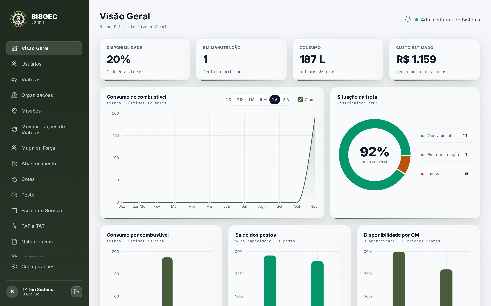

<p align="center">
  
</p>

<h1 align="center">SISGEC — Sistema de Gestão e Controle</h1>

<p align="center">
  Gestão de frota, combustível, efetivo e serviço de uma organização militar, num só sistema web.<br>
  <b>Vitrine do projeto:</b> o que ele faz, como foi construído e o manual do usuário com as telas.
</p>

> [!NOTE]
> Este repositório mostra o sistema; **o código-fonte não está aqui**. Todas as telas e vídeos foram feitos numa cópia de demonstração com **dados fictícios** (Brigada Modelo, B Log Mdl, 1º BI Mdl).



## O problema

Viaturas, missões, pedidos de combustível, cotas, efetivo pronto, escala de serviço, TAF e deslocamentos costumam viver em planilhas separadas, uma por seção. O mesmo militar aparece "pronto" numa e "de férias" em outra. Pedidos de combustível circulam por papel e o estoque do posto só fecha no fim do mês.

O SISGEC junta tudo numa base única, com cada etapa registrada: quem fez, quando e por quê.

## Os 14 módulos

| | Módulo | O que resolve |
|---|---|---|
| 01 | **Usuários** | Contas, perfis e redefinição de senha |
| 02 | **Viaturas** | Cadastro, situação, disponibilidade e histórico |
| 03 | **Organizações** | OMs, postos de combustível e órgão controlador |
| 04 | **Missões** | Planejamento e aprovação; motorista e efetivo conferidos contra férias, dispensas e serviço |
| 05 | **Movimentações** | Saída e chegada de viaturas no portão |
| 06 | **Mapa da Força** | Efetivo e situação de cada militar, numa regra única de quem está fora |
| 07 | **Abastecimento** | Pedido → autorização → bomba, com segregação de funções |
| 08 | **Cotas** | Cotas de combustível, saldo e débitos entre OMs |
| 09 | **Posto** | Régua diária do tanque e livro de lacres |
| 10 | **Escala de Serviço** | Quadro de folgas automático (preta e vermelha) e trocas |
| 11 | **TAF e TAT** | Leitura do Boletim Interno em PDF e lançamento dos resultados |
| 12 | **Notas Fiscais** | Notas de combustível com anexo e conferência |
| 13 | **Relatórios** | Relatórios por módulo e trilha de auditoria |
| 14 | **QSGR** | Deslocamentos publicados em BI e o quadro de controle |

## Manual do usuário

Cada módulo é um capítulo, com passo a passo e telas.

| Capítulo | Módulo |
|---|---|
| 00 | [Introdução](manual/00-introducao.md) |
| 01 | [Usuários](manual/01-usuarios.md) |
| 02 | [Viaturas](manual/02-viaturas.md) |
| 03 | [Organizações](manual/03-organizacoes.md) |
| 04 | [Missões](manual/04-missoes.md) |
| 05 | [Movimentações de Viaturas](manual/05-movimentacoes.md) |
| 06 | [Mapa da Força](manual/06-mapa-da-forca.md) |
| 07 | [Abastecimento](manual/07-abastecimento.md) |
| 08 | [Cotas](manual/08-cotas.md) |
| 09 | [Posto](manual/09-posto.md) |
| 10 | [Escala de Serviço](manual/10-escala.md) |
| 11 | [TAF e TAT](manual/11-taf-tat.md) |
| 12 | [Notas Fiscais](manual/12-notas-fiscais.md) |
| 13 | [Relatórios](manual/13-relatorios.md) |
| 14 | [QSGR](manual/14-qsgr.md) |

**PDF:** [`pdf/manual-sisgec.pdf`](pdf/manual-sisgec.pdf), gerado a partir dos capítulos.

## Vídeos

| Vídeo | Duração |
|---|---|
| [Abastecimento: fazer uma solicitação](videos/abastecimento-solicitacao.webm) | ~30 s |

## Como foi construído

| Camada | Tecnologia |
|---|---|
| Interface | React 19, TypeScript, Vite, Tailwind CSS 4 |
| API | Python, FastAPI, Pydantic |
| Banco | PostgreSQL 16, SQLAlchemy, Alembic (migrações versionadas) |
| Leitura de documentos | PyMuPDF e Tesseract (OCR) para Boletins Internos em PDF, inclusive os digitalizados |
| Entrega | Docker Compose (banco, API e nginx), numa VM da própria rede, sem exposição à internet |
| Qualidade | Mais de 450 testes automatizados (pytest), ruff, eslint e `tsc`, em CI no GitHub Actions a cada mudança |

### Segurança, por construção

- **Isolamento entre OMs no próprio banco:** Row Level Security do PostgreSQL. A API conecta com um papel sem privilégio, e uma OM não lê os dados de outra nem por erro de código.
- **Segregação de funções:** quem pede combustível não autoriza nem abastece, nem mesmo o administrador.
- **Trilha de auditoria gravada pelo servidor:** toda alteração vira registro, com autor tirado da sessão e IP da conexão. A tela não consegue forjar nem pular a trilha, e um teste falha se uma rota nova ficar fora dela.
- **Permissões por perfil** em matriz editável (consultar × alterar), com 16 perfis.
- **Senhas com bcrypt**, troca obrigatória no primeiro acesso, sessão de 60 minutos e bloqueio após tentativas erradas.
- **Dados pessoais protegidos:** a data de nascimento fica no banco, para a antiguidade da escala, e não sai para as telas.

### Uma regra só para "quem está fora"

Férias, dispensas e licenças publicadas em BI, deslocamentos do QSGR e serviço de escala alimentam **uma única regra**. O Mapa da Força, as Missões, a Escala e o quadro de folgas fazem a mesma pergunta e recebem a mesma resposta. Quem está de férias não aparece como pronto, não é escalado e não é oferecido como motorista.

## Autor

**Ezaú Laurentino Paulino**, 1º Sgt do Exército Brasileiro: idealizador, desenvolvedor e responsável pelo SISGEC.

- GitHub: [@Abuhlaurent](https://github.com/Abuhlaurent)
- LinkedIn: [ezaulaurentino](https://www.linkedin.com/in/ezaulaurentino)

## Estrutura deste repositório

```
manual/      capítulos em Markdown e as telas (img/)
pdf/         manual em PDF
videos/      gravações de operação
ferramentas/ gerador do PDF (Markdown -> HTML -> PDF)
```
