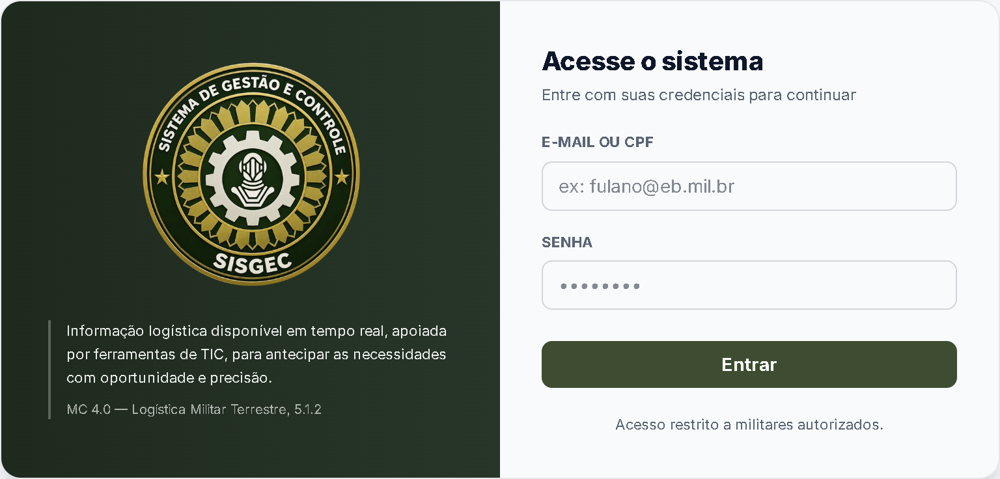
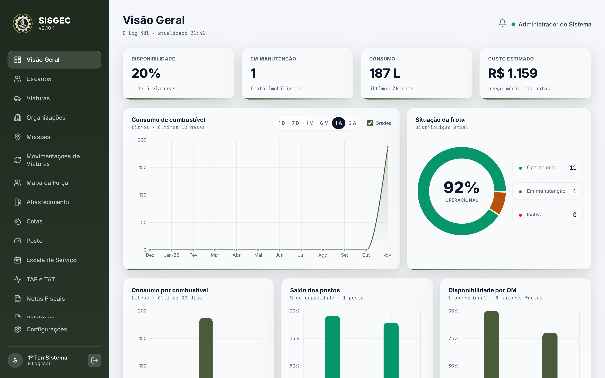

# Introdução

O **SISGEC — Sistema de Gestão e Controle** reúne num só lugar o que as seções de uma OM costumam controlar em planilhas soltas: viaturas, missões, combustível, efetivo, escala de serviço, TAF e TAT, notas fiscais e deslocamentos. Cada módulo deste manual é um capítulo, com o passo a passo e as telas.

> [!NOTE]
> Ao final deste capítulo, o usuário saberá:
>
> - como entrar no sistema e trocar a senha no primeiro acesso;
> - o que a tela inicial mostra;
> - por que cada pessoa vê um menu diferente;
> - onde ficam os avisos e as preferências da conta.

> [!NOTE]
> **DADOS DESTE MANUAL**
>
> Todas as telas foram feitas numa cópia de demonstração, com **OMs, militares e viaturas fictícios** (Brigada Modelo, B Log Mdl, 1º BI Mdl). Nenhum dado real aparece aqui.

## 1. Entrar no sistema

1. Abra o endereço do SISGEC no navegador da rede da OM.
2. Informe o **e-mail** ou o **CPF** e a **senha**.
3. Clique em **Entrar**.

No **primeiro acesso**, o sistema exige trocar a senha antes de abrir qualquer tela: a senha inicial foi definida por outra pessoa. A nova senha precisa ter no mínimo 10 caracteres, com uma letra maiúscula, um número e um caractere especial.

> [!WARNING]
> **ATENÇÃO**
>
> A sessão dura **60 minutos**. Depois disso o sistema pede a senha de novo. Errar a senha várias vezes seguidas bloqueia novas tentativas por alguns minutos.

## 2. A tela inicial (Visão Geral)

A **Visão Geral** é o resumo da OM, atualizado a cada acesso:

| Bloco | O que mostra |
|---|---|
| Disponibilidade | Percentual de viaturas operacionais e disponíveis |
| Em manutenção | Viaturas imobilizadas |
| Consumo | Litros abastecidos nos últimos 30 dias |
| Custo estimado | Consumo multiplicado pelo preço médio das notas fiscais |
| Consumo de combustível | Gráfico por período (1 dia a 2 anos) |
| Situação da frota | Operacional, em manutenção e inativa |
| Saldo dos postos | Quanto cada posto tem em relação à capacidade |

## 3. O menu muda conforme o perfil

Cada usuário tem um **perfil** (S4, Sargento do Posto, Sargenteante, Auditor e outros). O perfil define quais módulos aparecem no menu e o que se pode fazer em cada um: só consultar ou também cadastrar e alterar.

O Administrador do Sistema ajusta essas permissões na **matriz de permissões**, em Configurações.

| Menu do Administrador | Menu de quem só pede combustível |
|---|---|
| Todos os 14 módulos | Visão Geral, Organizações, Missões, Movimentações, Abastecimento, Cotas, Notas Fiscais e Relatórios |

> [!NOTE]
> **SEGREGAÇÃO DE FUNÇÕES**
>
> Algumas regras valem até para o Administrador. Exemplo: quem **pede** combustível não pode **autorizar** nem **abastecer** o próprio pedido (Capítulo 7).

## 4. Avisos e preferências

- **Sino** (canto superior direito): avisos dirigidos à sua OM e ao seu perfil, como "nova solicitação de abastecimento" ou "cota recebida".
- **Configurações** (rodapé do menu): aparência (tema claro ou escuro) e troca de senha. A aparência vale para a conta, em qualquer computador.
- **Sair**: botão ao lado do seu nome, no rodapé do menu.

## 5. Os capítulos deste manual

| Cap. | Módulo | Cap. | Módulo |
|---|---|---|---|
| 01 | Usuários | 08 | Cotas |
| 02 | Viaturas | 09 | Posto |
| 03 | Organizações | 10 | Escala de Serviço |
| 04 | Missões | 11 | TAF e TAT |
| 05 | Movimentações de Viaturas | 12 | Notas Fiscais |
| 06 | Mapa da Força | 13 | Relatórios |
| 07 | Abastecimento | 14 | QSGR |
