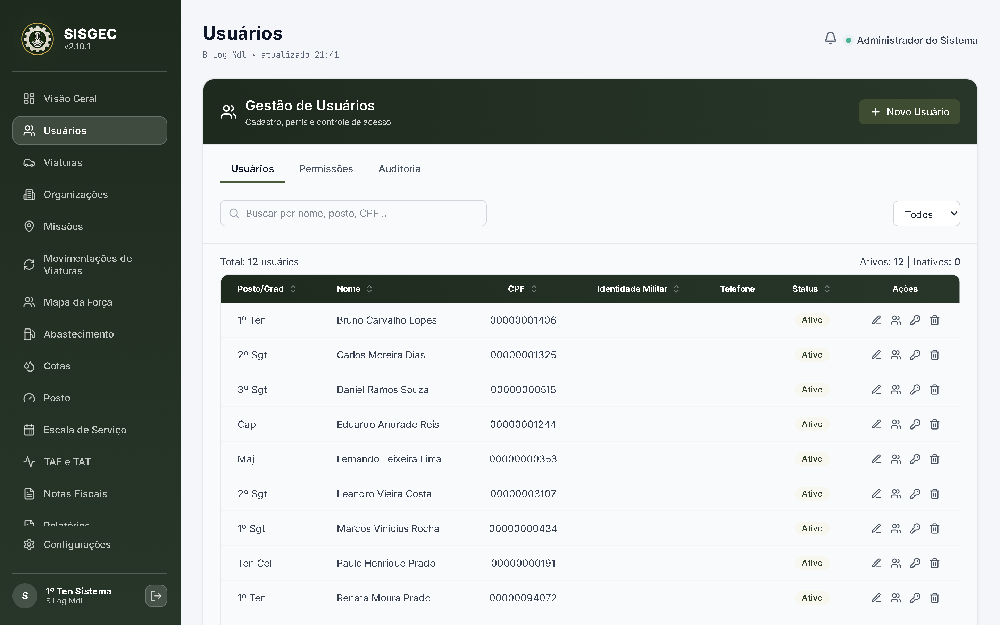
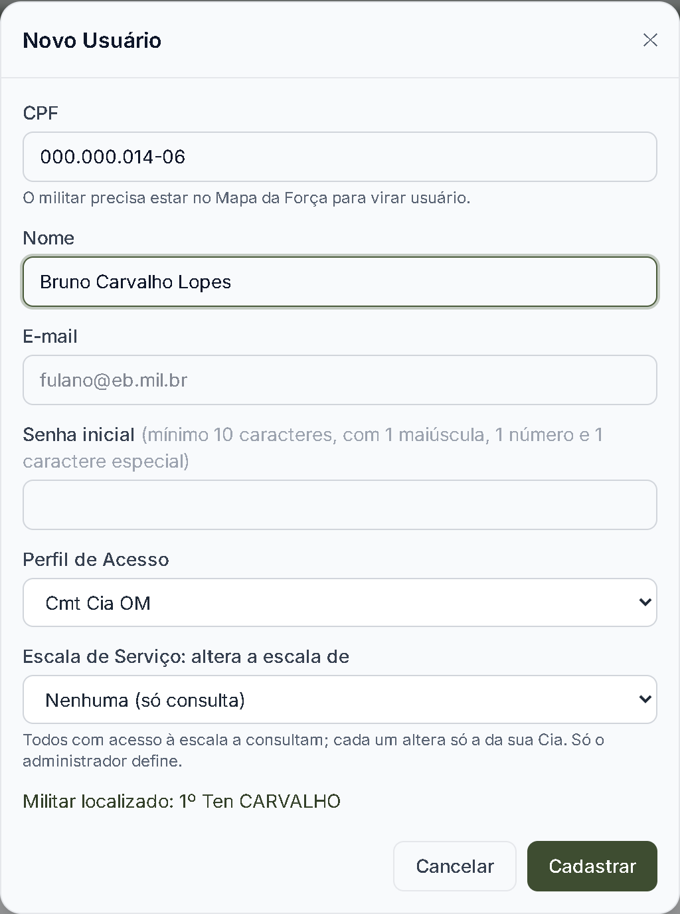
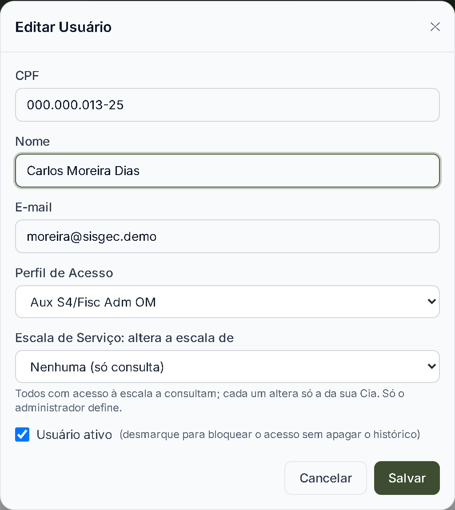
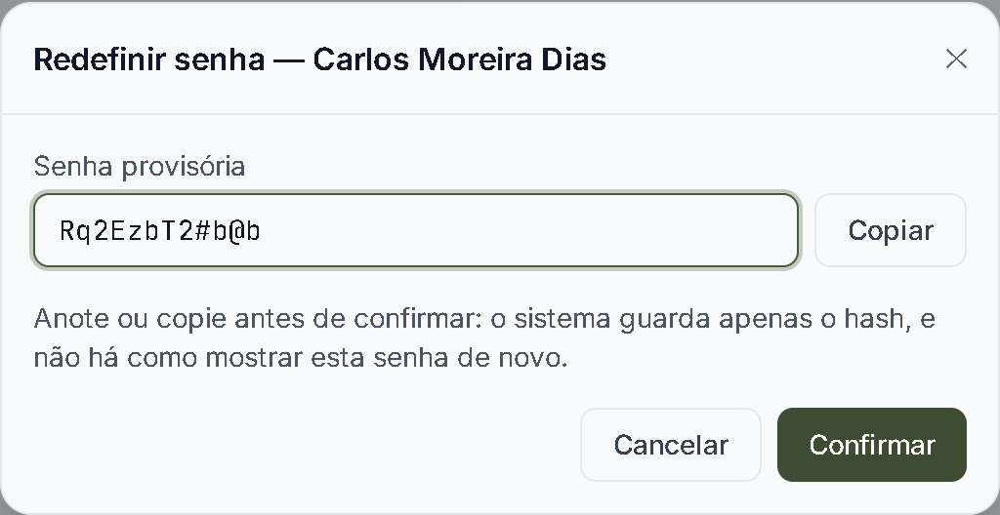
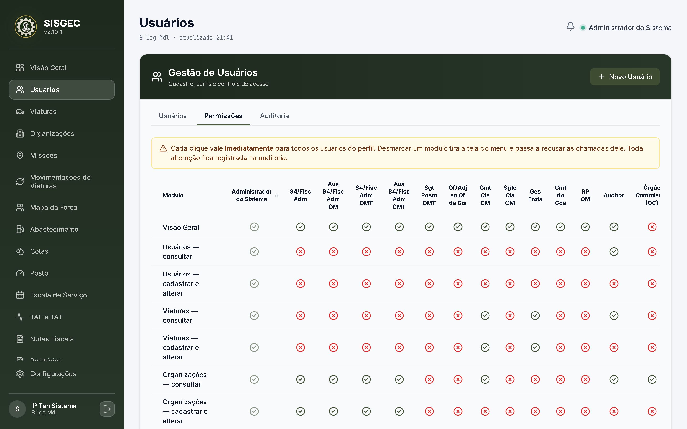

# Usuários

Aqui se criam as contas de acesso, se escolhe o perfil de cada pessoa e se redefine a senha de quem a esqueceu. O Administrador do Sistema também ajusta, nesta tela, o que cada perfil pode fazer.

> [!NOTE]
> Ao final deste capítulo, o usuário saberá:
>
> - cadastrar uma conta a partir de um militar do Mapa da Força;
> - alterar o perfil, inativar e excluir uma conta;
> - redefinir a senha de quem a esqueceu;
> - ler e alterar a matriz de permissões (Administrador).

## 1. A lista de usuários

A tela tem três abas: **Usuários**, **Permissões** (só o Administrador vê) e **Auditoria**. A busca procura por nome, posto ou CPF, e o seletor ao lado filtra **ativos** e **inativos**. Cada coluna com setas pode ser ordenada.

| Ícone | Ação |
|---|---|
| Lápis | Editar o cadastro e o perfil |
| Pessoas | Ativar ou inativar a conta |
| Chave | Redefinir a senha |
| Lixeira | Excluir a conta |

## 2. Cadastrar um usuário

Toda conta nasce de um militar que **já está no Mapa da Força** (Capítulo 6). Não existe usuário sem militar, e por isso não há importação de usuários por planilha.

1. Clique em **Novo Usuário**.
2. Digite o **CPF** e passe para o campo seguinte. O sistema procura o militar, preenche o nome e mostra "Militar localizado".
3. Informe o **e-mail institucional** (@eb.mil.br).
4. Defina uma **senha inicial**: no mínimo 10 caracteres, com maiúscula, número e caractere especial.
5. Escolha o **perfil de acesso**.
6. Em **Escala de Serviço**, escolha qual escala a pessoa altera. "Nenhuma" deixa só consultar.
7. Clique em **Cadastrar**.

> [!WARNING]
> **SENHA INICIAL**
>
> Quem cadastra conhece a senha inicial, então ela é provisória: no primeiro acesso, o sistema obriga o dono da conta a trocá-la antes de abrir qualquer tela.

A conta é criada na **OM do militar**, não na de quem cadastra.

## 3. Alterar, inativar e excluir

No **lápis**, altere nome, e-mail, perfil e escala. Desmarque **Usuário ativo** para bloquear o acesso sem apagar nada.

| Quer... | Use | O que acontece |
|---|---|---|
| Bloquear o acesso | Inativar | A pessoa não entra mais, e o histórico fica intacto |
| Apagar a conta | Excluir | Só funciona se a conta nunca operou nada |

O sistema **recusa excluir** a conta de quem registrou movimentação de viatura ou participou de um abastecimento (pediu, autorizou ou abasteceu). O histórico operacional não pode sumir. Nesses casos, **inative**.

> [!NOTE]
> **PROTEÇÕES DA CONTA**
>
> - Ninguém altera o **próprio perfil**, se inativa ou se exclui.
> - Só o Administrador cria outro Administrador, muda alguém de OM ou define quem altera cada escala.
> - Quem não é Administrador não altera, não redefine e não exclui conta de Administrador.

## 4. Redefinir a senha de quem esqueceu

1. Clique na **chave** na linha do usuário.
2. O sistema gera uma **senha provisória**.
3. **Copie ou anote antes de confirmar.** Depois que a janela fecha, ela não pode ser vista de novo, porque o sistema guarda só a versão cifrada.
4. Confirme e entregue a senha ao dono da conta. Ele terá de trocá-la no próximo acesso.

Quem troca a **própria** senha não usa esta tela: vai em **Configurações → Conta**, que pede a senha atual.

## 5. Matriz de permissões (Administrador)

Cada **linha** é um módulo e o que se faz nele: "consultar" ou "cadastrar e alterar". No Abastecimento, as linhas são as próprias abas. Cada **coluna** é um perfil. Clique no ícone para liberar (✓ verde) ou negar (✗ vermelho).

> [!WARNING]
> **VALE NA HORA**
>
> Cada clique vale **imediatamente** para todos os usuários daquele perfil. Negar um módulo tira a tela do menu, e o servidor passa a recusar as chamadas dele. Toda alteração fica registrada na auditoria. A coluna do Administrador do Sistema não se altera.

## 6. Auditoria

A aba **Auditoria** lista o que foi feito nas contas: cadastro, edição, ativação, inativação e exclusão, com data, hora e autor. Dá para filtrar pelo tipo de ação ou buscar pelo nome.

## 7. Resumo

> [!TIP]
> - Usuário nasce de um **militar do Mapa da Força**, pelo CPF.
> - A senha inicial e a redefinida são **provisórias**: o dono troca no primeiro acesso.
> - Para bloquear alguém, **inative**. Excluir só funciona em conta sem histórico.
> - Ninguém mexe no **próprio perfil** nem promove alguém a Administrador sem ser um.
> - A **matriz de permissões** vale na hora para o perfil inteiro.
