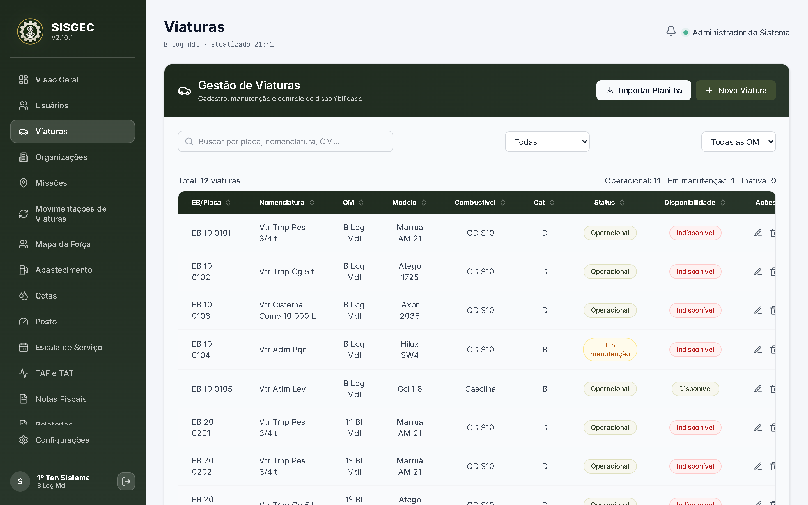
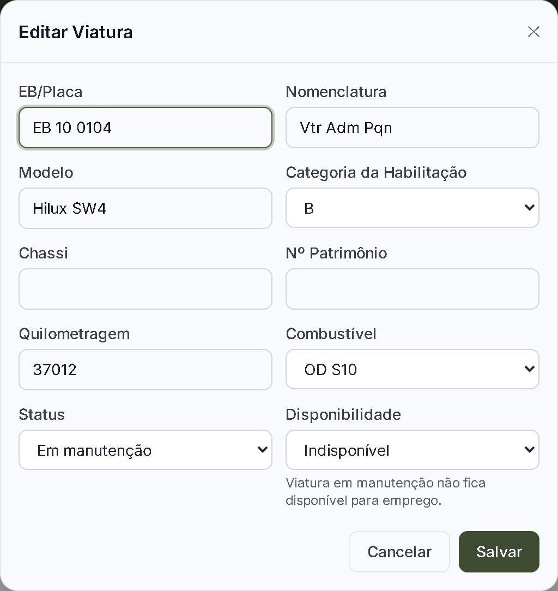
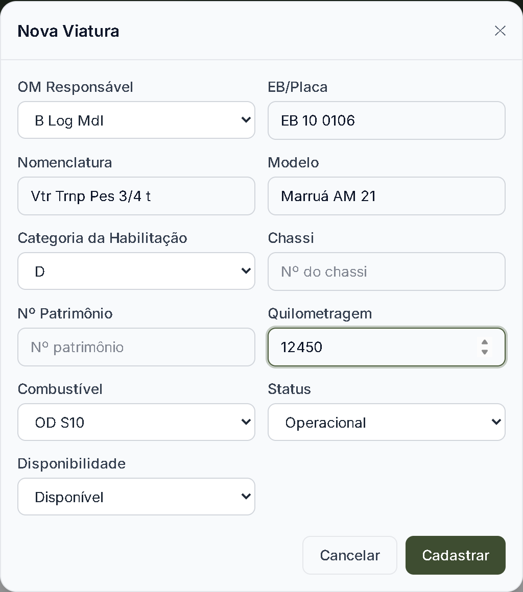
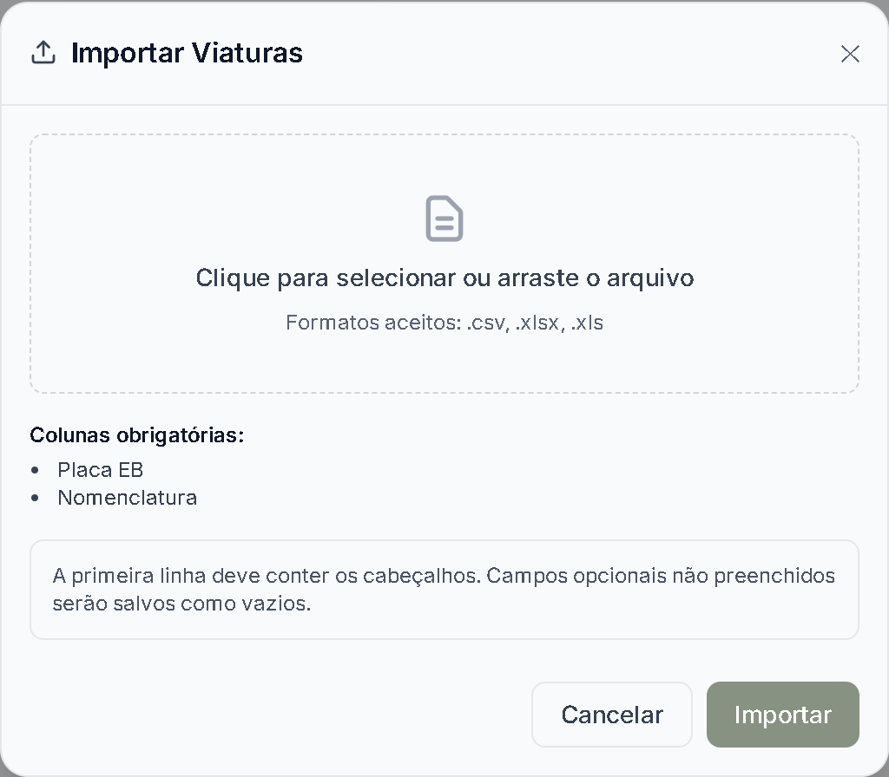

# Viaturas

O cadastro da frota: cada viatura com placa EB, modelo, combustível, a categoria de habilitação que exige do motorista e a sua situação. É daqui que Missões, Movimentações e Abastecimento tiram as viaturas que oferecem.

> [!NOTE]
> Ao final deste capítulo, o usuário saberá:
>
> - consultar a frota e filtrar por situação e por OM;
> - cadastrar uma viatura, uma a uma ou por planilha;
> - mudar a situação de uma viatura (operacional, em manutenção, inativa);
> - por que a categoria de habilitação precisa estar preenchida.

## 1. A lista de viaturas

A busca procura por placa, nomenclatura, modelo, chassi e número de patrimônio. Ao lado, dois filtros:

- **Situação:** todas, operacional, em manutenção ou inativa;
- **OM:** aparece só para quem enxerga mais de uma OM, como o Administrador do Sistema.

Acima da tabela ficam o total e a contagem por situação. Esses números são da frota inteira, não só da página exibida. A coluna **Cat** é a categoria de habilitação que a viatura exige do motorista. Cada coluna com setas pode ser ordenada.

| Ícone | Ação |
|---|---|
| Lápis | Editar a viatura |
| Lixeira | Excluir a viatura |

Quem só tem permissão de consultar não vê os botões **Nova Viatura**, **Importar Planilha** e a coluna **Ações**.

## 2. Situação e disponibilidade

São dois campos diferentes, mas amarrados:

| Situação (status) | Disponibilidade |
|---|---|
| Operacional | Disponível ou Indisponível, à escolha |
| Em manutenção | Sempre Indisponível |
| Inativa | Sempre Indisponível |

**Só a viatura Operacional pode estar Disponível.** Ao escolher "Em manutenção" ou "Inativa", o campo de disponibilidade trava em "Indisponível" e a tela explica o motivo.

## 3. Cadastrar uma viatura

1. Clique em **Nova Viatura**.
2. **OM Responsável:** o Administrador escolhe a OM. Para os demais, a viatura nasce na própria OM.
3. Preencha **EB/Placa** e **Nomenclatura** (obrigatórios), e o **Modelo**.
4. Escolha a **Categoria da Habilitação** que o motorista precisa ter (A a E). "Não definida" deixa o campo em branco, mas a viatura fica sem receber motorista em Missões até ser preenchida.
5. Informe chassi, número de patrimônio e quilometragem, se tiver.
6. Escolha o **Combustível**: OD S10, OD S500 ou Gasolina.
7. Defina **Status** e **Disponibilidade** e clique em **Cadastrar**.

> [!WARNING]
> **CATEGORIA DE HABILITAÇÃO**
>
> Missões usa essa categoria para conferir se o motorista escalado é habilitado para a viatura. Viatura sem categoria não recebe motorista, e a tela de Missões avisa quantas estão nessa situação.

> [!NOTE]
> **COMBUSTÍVEL**
>
> O combustível cadastrado é o que o Abastecimento preenche sozinho no pedido. Viatura com combustível fora das três opções não consegue pedir abastecimento.

## 4. Importar por planilha

Para cadastrar a frota de uma vez:

1. Clique em **Importar Planilha**.
2. Escolha o arquivo **.csv**, **.xlsx** ou **.xls**. A primeira linha precisa ter os cabeçalhos.
3. Clique em **Importar**. O sistema mostra quantas linhas entraram e o erro de cada uma que ficou de fora.

| Coluna | Obrigatória |
|---|---|
| Placa EB | Sim |
| Nomenclatura | Sim |
| Modelo, Categoria, Categoria HAB, Status, Combustível | Não |

A planilha pode trazer também **Sigla OM**, **Chassi**, **Patrimônio** e **Quilometragem**. Sem a sigla, a viatura vai para a OM de quem importa. Uma linha é recusada quando:

- a placa já existe naquela OM (a placa é única por OM);
- a sigla da OM não existe;
- quem importa não tem permissão sobre aquela OM;
- o status não é um dos três válidos.

## 5. Excluir

A lixeira pede confirmação. O sistema recusa excluir a viatura que já tem registros ligados a ela (missões, movimentações, abastecimentos). Nesse caso, mude o status para **Inativa**: ela sai do emprego e o histórico fica.

## 6. Resumo

> [!TIP]
> - **Só a Operacional fica Disponível**: em manutenção e inativa travam como indisponíveis.
> - Preencha a **categoria de habilitação**, ou a viatura não recebe motorista em Missões.
> - O **combustível** do cadastro é o que o pedido de abastecimento usa.
> - Planilha: **Placa EB** e **Nomenclatura** bastam, e a placa é única por OM.
> - Viatura com histórico não se exclui: **inative**.
