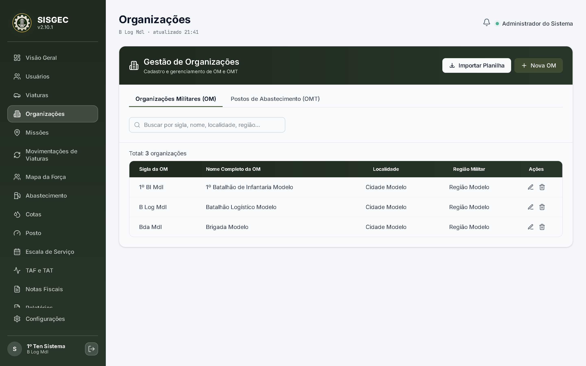
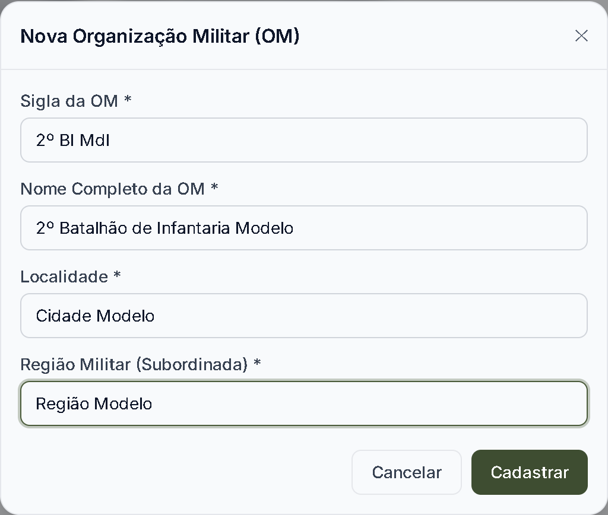
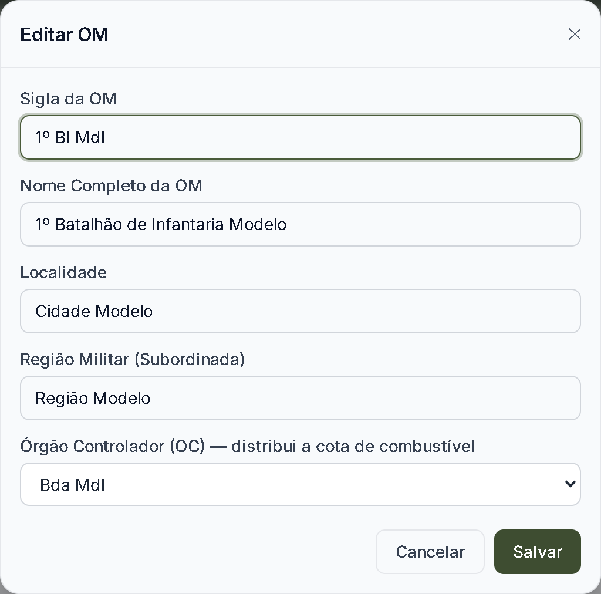
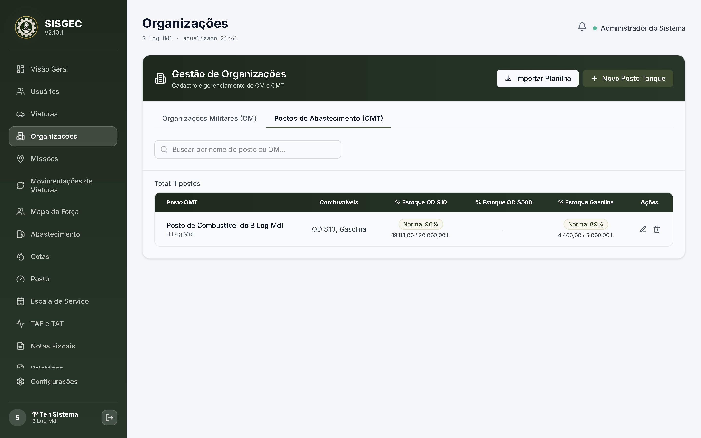
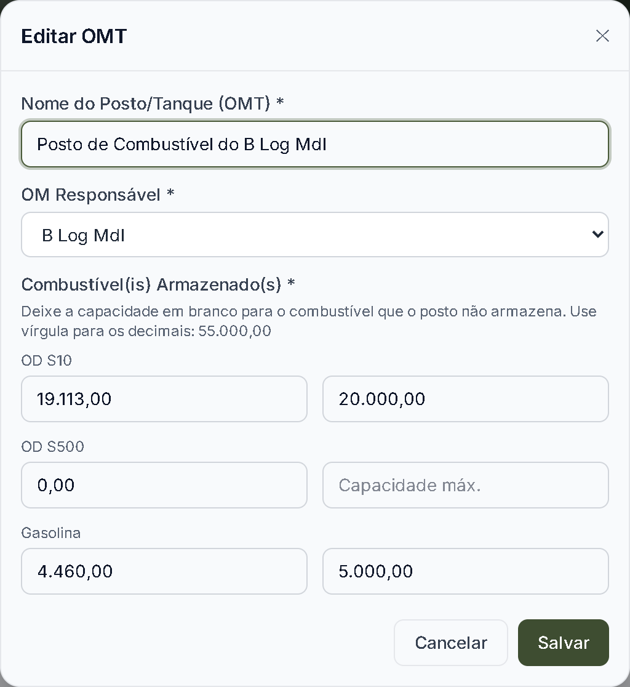

# Organizações

Aqui ficam as **OMs** que usam o sistema e os **postos de abastecimento (OMT)** de cada uma. É do cadastro da OM que sai o **Órgão Controlador (OC)**, quem distribui a cota de combustível dela (Capítulo 8). É do cadastro do posto que sai o estoque que o Abastecimento baixa (Capítulo 7).

> [!NOTE]
> Ao final deste capítulo, o usuário saberá:
>
> - consultar as OMs e os postos de abastecimento;
> - cadastrar uma OM e definir o seu Órgão Controlador (Administrador);
> - cadastrar e ajustar um posto, com os combustíveis e a capacidade de cada tanque;
> - ler o alerta de estoque crítico.

## 1. As duas abas

| Aba | O que mostra |
|---|---|
| Organizações Militares (OM) | Sigla, nome completo, localidade e região militar de cada OM |
| Postos de Abastecimento (OMT) | Cada posto, a OM dona, os combustíveis e o percentual de estoque |

A busca filtra a aba aberta: na de OM, por sigla, nome, localidade ou região; na de postos, pelo nome do posto ou pelo combustível.

## 2. Cadastrar uma OM (Administrador)

1. Na aba **Organizações Militares (OM)**, clique em **Nova OM**.
2. Preencha **sigla**, **nome completo**, **localidade** e **região militar**. Os quatro são obrigatórios.
3. Clique em **Cadastrar**.

> [!NOTE]
> **CADA OM É ISOLADA**
>
> A OM nova nasce separada das demais: os dados que ela lançar não aparecem para as outras OMs, nem para a OM de quem a cadastrou.

Para cadastrar várias de uma vez, use **Importar Planilha** (.csv, .xlsx ou .xls) com as colunas **Sigla da OM**, **Nome Completo da OM**, **Localidade** e **Região Militar (Subordinada)**.

## 3. Definir o Órgão Controlador (OC)

O OC é a OM que **distribui a cota de combustível** desta OM e acompanha os débitos dela.

1. Clique no **lápis** da OM.
2. Em **Órgão Controlador (OC)**, escolha a OM que distribui a cota.
3. Clique em **Salvar**.

Se ninguém escolher, a OM nova recebe o OC que a maioria das OMs já usa. Uma OM não pode ser o OC de si mesma.

> [!WARNING]
> **SÓ O ADMINISTRADOR**
>
> Cadastrar, alterar, excluir e importar **OM** é restrito ao Administrador do Sistema: mexer na OM muda o que cada usuário enxerga. Para os demais, a aba de OMs é só consulta: os botões **Nova OM** e **Importar Planilha** e os ícones de editar e excluir não aparecem.

## 4. Postos de abastecimento (OMT)

Todas as OMs veem todos os postos: é assim que a OM escolhe onde pedir combustível. Mas só a **OM dona do posto** o cadastra, altera e exclui. O Administrador pode fazer isso em qualquer posto.

Cada combustível aparece com o percentual do tanque e os litros (carga / capacidade):

| Etiqueta | Estoque |
|---|---|
| Normal | 70% ou mais |
| Baixo | de 30% a 69% |
| Crítico | abaixo de 30% |

Quando algum tanque fica **abaixo de 30%**, aparece no alto da aba o quadro vermelho **Alertas de Estoque Crítico**, com uma etiqueta por posto e combustível mostrando o percentual. O quadro só avisa: o pedido de remessa de combustível segue pelo canal normal, fora do sistema.

**Cadastrar ou ajustar um posto**

1. Na aba **Postos de Abastecimento (OMT)**, clique em **Novo Posto Tanque**, ou no **lápis** do posto.
2. Informe o **nome do posto** e a **OM responsável**.
3. Para cada combustível armazenado (OD S10, OD S500, Gasolina), informe a **carga líquida** e a **capacidade máxima**. Deixe a capacidade em branco no combustível que o posto não tem. Use vírgula para os decimais.
4. Clique em **Salvar**.

> [!NOTE]
> **DE ONDE VEM O ESTOQUE**
>
> Depois de cadastrado, o estoque do posto cai a cada abastecimento confirmado na bomba (Capítulo 7). A conferência física do tanque é a régua diária, no módulo Posto (Capítulo 9).

## 5. Resumo

> [!TIP]
> - OM e OC são cadastro do **Administrador**. Posto é cadastro da **OM dona**.
> - O **OC** de cada OM é quem distribui a cota dela.
> - Todo posto é visível para todas as OMs, para escolherem onde abastecer.
> - Tanque abaixo de **30%** aparece como **Crítico**, com alerta no alto da aba.
