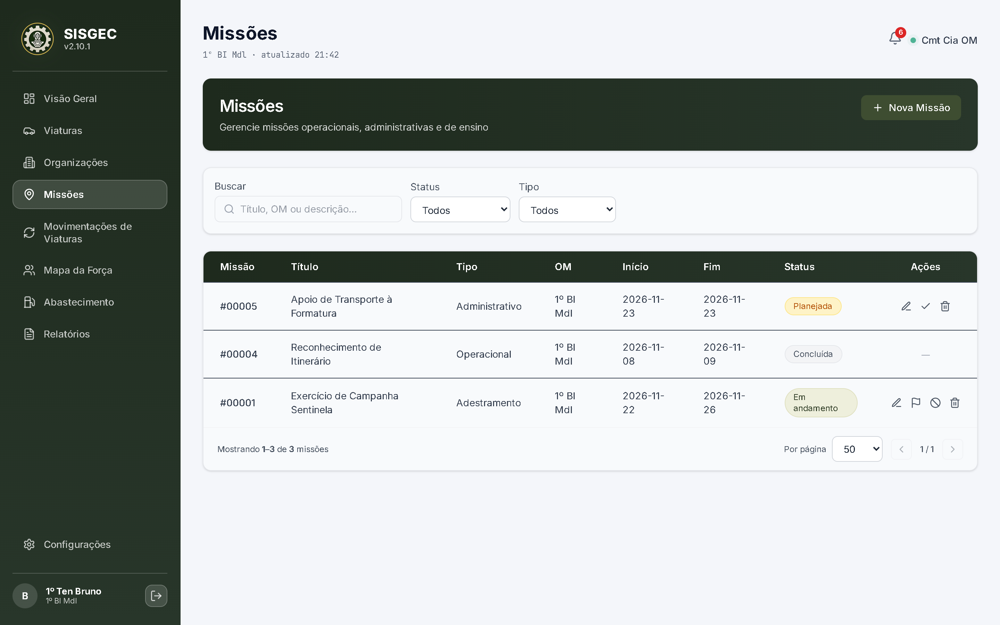
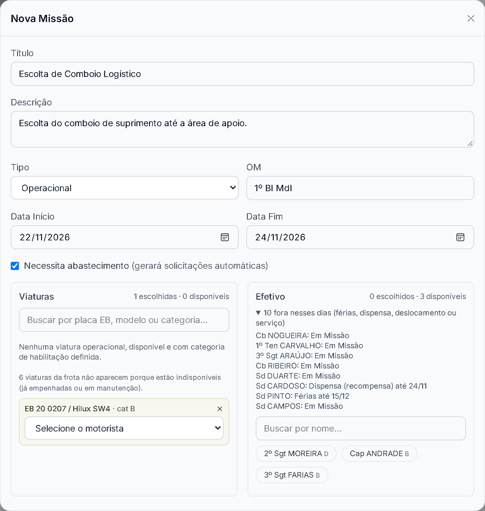
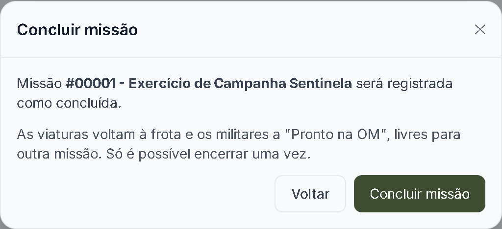

# Missões

A missão reúne num só registro o que vai sair, quem vai e quando: as viaturas, o motorista de cada uma e o efetivo. Ao montá-la, o sistema só oferece quem está disponível nos dias da missão, pela mesma regra do Mapa da Força.

> [!NOTE]
> Ao final deste capítulo, o usuário saberá:
>
> - cadastrar uma missão com viaturas, motoristas e efetivo;
> - entender por que um militar ou uma viatura não aparece para escolha;
> - aprovar, concluir e cancelar uma missão;
> - o que a aprovação muda na viatura e no militar.

## 1. A lista de missões

A lista mostra o número, o título, o tipo, a OM, as datas e a situação de cada missão. Os filtros acima procuram por título, OM ou descrição, por **status** e por **tipo** (Administrativo, Operacional, SFPC, Ensino ou Outros).

| Status | Significado | Ações na linha |
|---|---|---|
| Planejada | Montada, ainda sem aprovação | Editar, Aprovar (✓), Excluir |
| Em andamento | Aprovada: viaturas e militares empenhados | Editar, Concluir (bandeira), Cancelar (⊘), Excluir |
| Concluída | Encerrada | Nenhuma |

## 2. Cadastrar uma missão

1. Clique em **Nova Missão**.
2. Preencha **título**, **descrição** e **tipo**. A **OM** é a sua e não se altera.
3. Informe **Data Início** e **Data Fim**. O fim não pode ser antes do início.
4. Marque **Necessita abastecimento** se as viaturas vão pedir combustível. Depois da aprovação, elas passam a aparecer na aba Solicitação do Abastecimento (Capítulo 7).
5. Em **Viaturas**, clique na placa para escolher. Para cada viatura escolhida, selecione o **motorista**.
6. Em **Efetivo**, clique no nome de quem vai.
7. Clique em **Salvar**. A missão nasce **Planejada**.

> [!NOTE]
> **QUEM APARECE NAS LISTAS**
>
> Assim que as datas são preenchidas, o sistema consulta quem está fora **naqueles dias**. A linha "N fora nesses dias" abre a lista com o nome e o motivo de cada um: em missão, férias ou dispensa publicadas em BI, deslocamento do QSGR ou serviço da escala. No exemplo, o Sd PINTO (férias) e o Sd CARDOSO (dispensa) não são oferecidos.

### Viaturas

O seletor mostra só as viaturas **operacionais**, **disponíveis** e com **categoria de habilitação** cadastrada. Logo abaixo, o sistema diz quantas viaturas da frota ficaram de fora e por quê: não operacionais, já empenhadas ou em manutenção, ou sem categoria definida.

### Motorista de cada viatura

Cada viatura tem o seu motorista. A lista de cada uma oferece só quem:

- está disponível nos dias da missão;
- tem habilitação cadastrada que cobre a categoria da viatura;
- ainda não é motorista de outra viatura nem está no efetivo desta missão.

Se ninguém se encaixa, a lista avisa: "Nenhum militar pronto e habilitado na categoria".

> [!WARNING]
> **O SERVIDOR CONFERE DE NOVO**
>
> Mesmo que a tela ofereça, o servidor recusa motorista ou militar que esteja fora no período, e viatura ou militar já empenhado em outra missão. A mensagem diz quem não pode ir e por quê.

> [!NOTE]
> **PERMISSÕES PARA MONTAR**
>
> Montar missão depende só do módulo **Missões** na matriz de permissões (Capítulo 1). As listas de viaturas e de efetivo da própria OM vêm junto com a tela, sem exigir consulta em Viaturas, Mapa da Força ou Organizações. Se as listas não carregarem, a tela mostra o erro em vermelho em vez de ficar vazia.

## 3. Alterar uma missão

Clique no **lápis**. O formulário abre com as viaturas, os motoristas e o efetivo já escalados. Dá para trocar o motorista, tirar ou incluir viaturas e pessoas.

Se as **datas mudarem** numa missão ainda aberta, o sistema confere de novo todos os escalados nos dias novos. Quem passou a estar fora impede a gravação, com o motivo.

## 4. Aprovar

Clique no **✓** de uma missão Planejada. Ela passa a **Em andamento** e empenha os meios:

- as viaturas ficam **Indisponíveis** para outras missões;
- motoristas e efetivo passam a **Em Missão** no Mapa da Força.

## 5. Concluir ou cancelar

Na missão Em andamento:

- **Concluir** (bandeira): a missão aconteceu e terminou;
- **Cancelar** (⊘): a missão não aconteceu.

Nos dois casos, as viaturas voltam à frota e os militares voltam a **Pronto na OM**, livres para outra missão. Só é possível encerrar uma vez.

O caminho normal é automático: quando a última viatura registra a chegada no portão e o prazo já se cumpriu, a missão se encerra sozinha (Capítulo 5). Os botões servem para o que o portão não fechou.

Missão **Planejada** que não vai acontecer não se cancela: **exclua**.

## 6. Resumo

> [!TIP]
> - A missão junta **viaturas, motoristas e efetivo** nos mesmos dias.
> - Só é oferecido quem está **disponível nos dias da missão**, e o motivo de quem ficou de fora aparece na tela.
> - Cada viatura tem **um motorista habilitado** na categoria dela.
> - **Aprovar** empenha viaturas e militares; **concluir** ou **cancelar** devolve tudo.
> - Mudar as datas faz o sistema **conferir todos de novo**.
