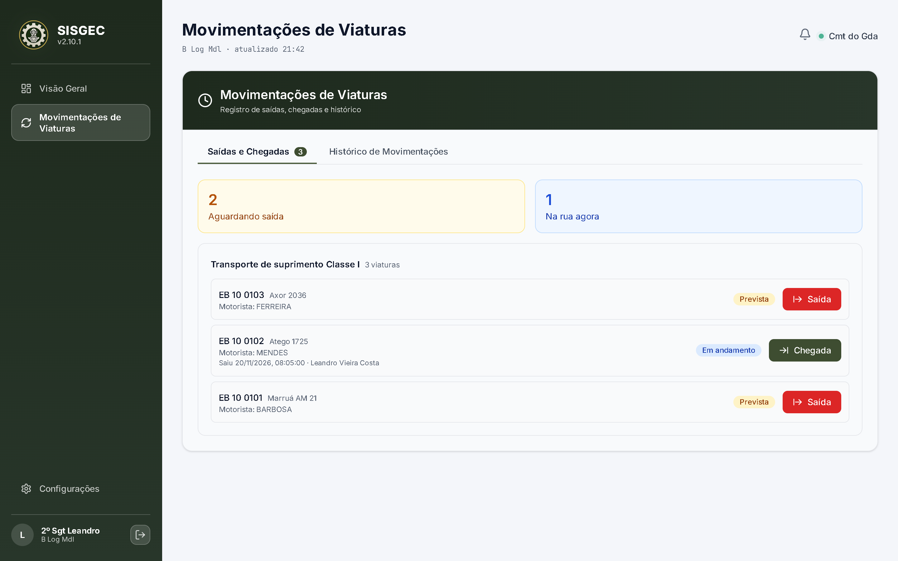
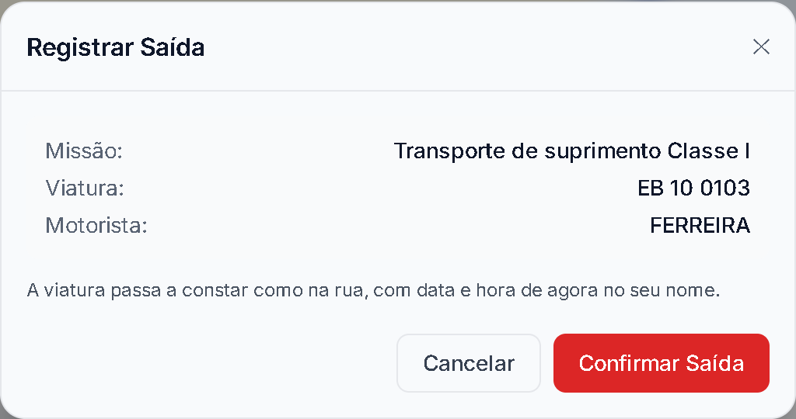
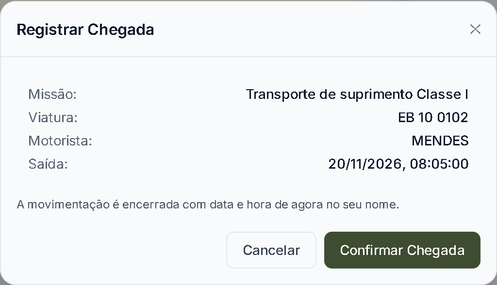
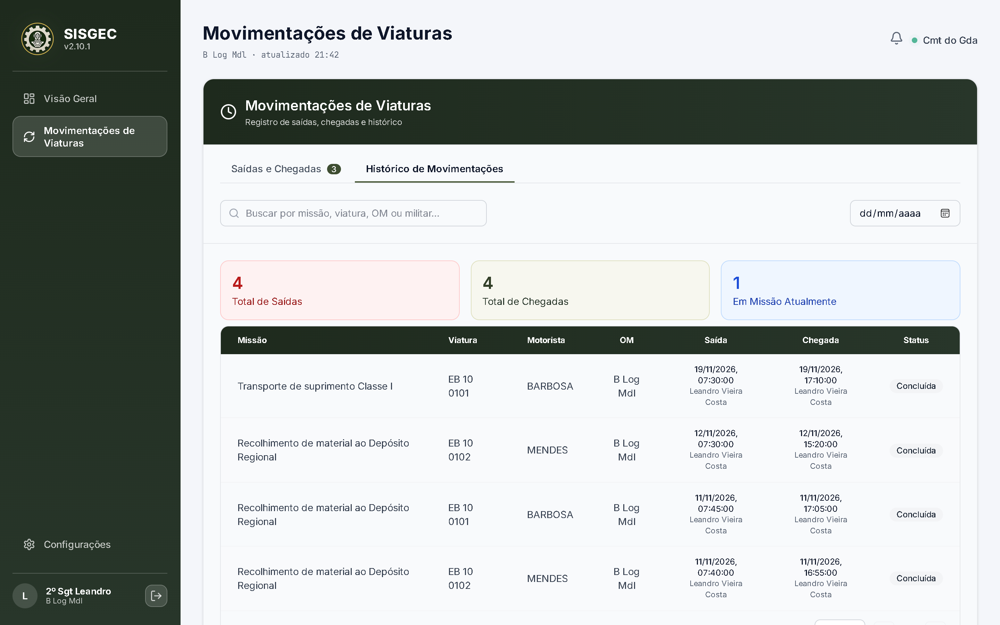

# Movimentações de Viaturas

O controle do portão: quando cada viatura de missão saiu, quando voltou e quem registrou. Quem opera esta tela no dia a dia é o **Comandante da Guarda**.

> [!NOTE]
> Ao final deste capítulo, o usuário saberá:
>
> - de onde vêm as viaturas que aparecem para sair;
> - registrar a saída e a chegada de uma viatura;
> - o que acontece quando a viatura volta antes do fim da missão;
> - consultar o histórico de viagens.

## 1. De onde vêm as viaturas

Ninguém cria movimentação nesta tela. Quando uma **missão é aprovada** (Capítulo 4), cada viatura dela ganha uma viagem **Prevista**, que aparece aqui esperando a saída.

| Situação | Significado |
|---|---|
| Prevista | No pátio, aguardando a saída |
| Em andamento | Saiu pelo portão; está na rua |
| Concluída | Voltou; a viagem foi encerrada |

## 2. A aba Saídas e Chegadas

No alto, dois contadores: **Aguardando saída** e **Na rua agora**. Abaixo, um cartão por **missão**, com uma linha por viatura. Cada linha mostra a placa, o modelo, o **motorista escalado** na missão e, se já saiu, a hora e quem registrou.

O número ao lado do nome da aba é o total de viaturas no pátio ou na rua.

## 3. Registrar a saída

1. Na linha da viatura **Prevista**, clique em **Saída** (botão vermelho).
2. Confira missão, viatura e motorista na janela.
3. Clique em **Confirmar Saída**.

A viatura passa a **Em andamento**, com a data e a hora do clique e o nome de quem confirmou.

> [!NOTE]
> **QUEM REGISTRA**
>
> Não há campo de nome nem de hora para preencher. O sistema grava o usuário logado e o relógio do servidor. Por isso a janela só recapitula o que vai ser gravado.

## 4. Registrar a chegada

1. Na linha da viatura **Em andamento**, clique em **Chegada**.
2. Confira os dados, inclusive a hora em que ela saiu.
3. Clique em **Confirmar Chegada**.

A viagem passa a **Concluída**. O que acontece em seguida depende da data de fim da missão:

| Quando a viatura volta | O sistema |
|---|---|
| Ainda há dias de missão pela frente | Abre sozinho uma nova viagem **Prevista** para a pernada seguinte |
| No último dia, e era a última viatura fora | **Encerra a missão** e devolve viaturas e militares à disponibilidade |

> [!WARNING]
> **SEGUNDA SAÍDA NO ÚLTIMO DIA**
>
> No último dia da missão, a volta não abre nova viagem automática: é assim que o pátio se esvazia sozinho quando a missão acaba. Uma segunda saída nesse mesmo dia não aparece sozinha nesta tela.

O sistema recusa registrar a saída de uma viatura que não está **Prevista**, ou a chegada de uma que não está **Em andamento**. Assim, a mesma viagem não sai duas vezes nem volta duas vezes.

## 5. Histórico de movimentações

Mostra as viagens **concluídas**, da mais recente para a mais antiga, com missão, viatura, motorista, OM, a saída e a chegada (data, hora e quem registrou).

- A **busca** procura por missão, placa, sigla da OM e nome de guerra do motorista.
- O **filtro de data** mostra as viagens que saíram naquele dia.
- Os contadores **Total de Saídas** e **Total de Chegadas** contam o histórico inteiro, não só a busca.

## 6. Resumo

> [!TIP]
> - A viagem nasce **Prevista** quando a missão é aprovada; ninguém a cria à mão.
> - **Saída** → Em andamento; **Chegada** → Concluída. Hora e autor são gravados sozinhos.
> - Missão com dias pela frente: a volta **abre a próxima viagem**.
> - No último dia, a volta da última viatura **encerra a missão**.
> - O histórico guarda cada viagem com quem registrou a saída e a chegada.
