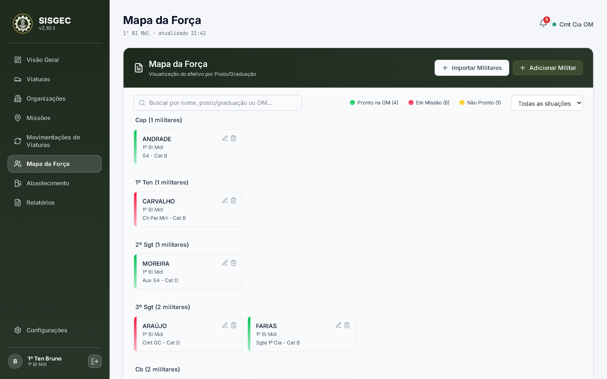
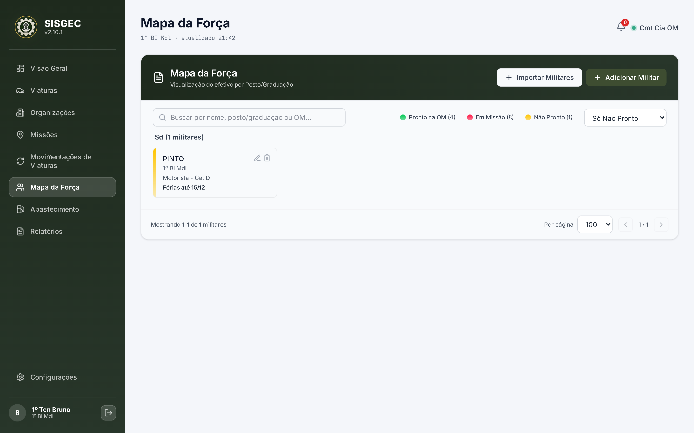
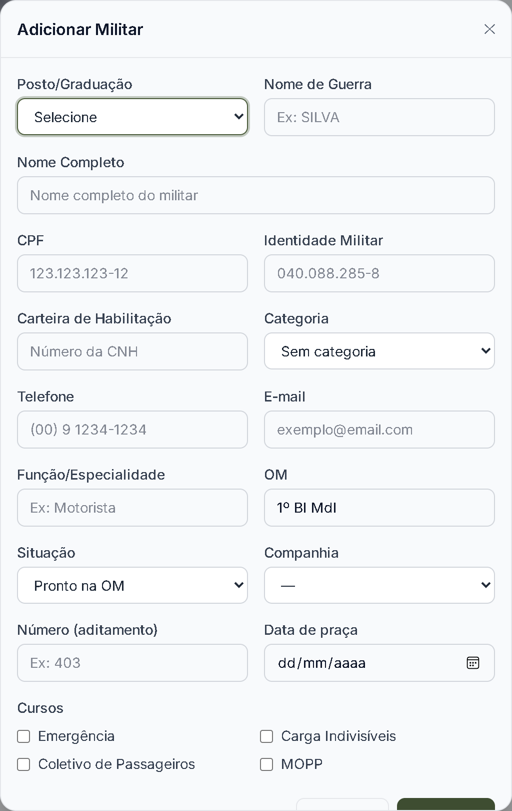
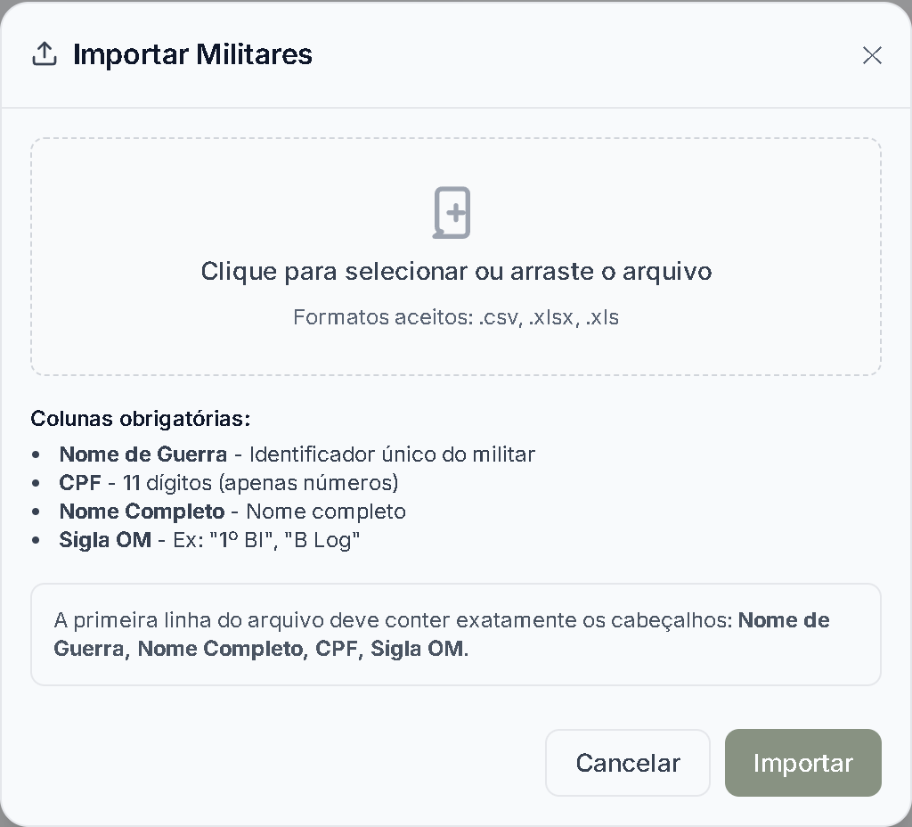

# Mapa da Força

O Mapa da Força é o efetivo da OM, agrupado por posto e graduação, com a situação de **hoje** de cada militar: pronto, em missão ou não pronto. É também a base do sistema: todo usuário, motorista, integrante de missão e militar da escala vem daqui.

> [!NOTE]
> Ao final deste capítulo, o usuário saberá:
>
> - ler o mapa e a situação de cada militar;
> - entender de onde vem cada situação;
> - cadastrar, alterar e excluir um militar;
> - importar o efetivo por planilha.

## 1. Ler o mapa

Cada cartão é um militar: nome de guerra, OM, função e categoria de habilitação. A faixa colorida à esquerda indica a situação do dia.

| Cor | Situação |
|---|---|
| Verde | Pronto na OM |
| Vermelho | Em Missão |
| Amarelo | Não Pronto |

A legenda no alto conta o efetivo inteiro em cada situação. O seletor ao lado mostra só uma delas. A busca procura pelo nome completo, nome de guerra, CPF, identidade, função, posto/graduação ("3º Sgt") ou sigla da OM.

Quando a situação vem de um fato com data, o cartão mostra o motivo, por exemplo "Férias até 15/12".

## 2. De onde vem a situação

A situação não é marcada só à mão. O sistema junta tudo o que tira o militar do dia e aplica **uma regra única**, a mesma usada em Missões, na Escala de Serviço e no quadro de folgas:

| Fonte | O que é | Situação no dia |
|---|---|---|
| Cadastro | Situação diferente de "Pronto na OM" marcada no cadastro | A do cadastro |
| Missão aprovada | Militar escalado numa missão Em andamento | Em Missão |
| Afastamento | Férias, dispensa ou licença publicada em BI | Não Pronto |
| QSGR | Deslocamento publicado | Em Missão |
| Escala | De serviço naquele dia | Em Missão |

> [!WARNING]
> **UMA REGRA PARA TODOS OS MÓDULOS**
>
> Quem está de férias aparece como Não Pronto aqui, não é oferecido como motorista nem como efetivo de missão (Capítulo 4) e não é escalado de serviço (Capítulo 10). Os números batem entre os módulos porque todos fazem a mesma pergunta.

Os afastamentos entram pela leitura do Boletim Interno, que reconhece férias, dispensas e licenças publicadas e as liga ao militar pelo nome.

## 3. Cadastrar um militar

1. Clique em **Adicionar Militar**.
2. Preencha posto ou graduação, nome de guerra, nome completo e CPF.
3. Preencha, se houver: identidade militar, número e **categoria** da CNH, telefone, e-mail e função.
4. Escolha a **situação**, a **companhia** e, para soldados, o número usado no aditamento.
5. Informe a **data de praça**. Entre militares do mesmo posto, ela desempata a antiguidade na escala.
6. Marque os **cursos** que o militar tem (Emergência, Carga Indivisíveis, Coletivo de Passageiros, MOPP).
7. Salve.

O militar é cadastrado na sua OM. Sem **categoria de habilitação**, ele não é oferecido como motorista: habilitação que o sistema não conhece não conta.

> [!NOTE]
> **NOME REPETIDO**
>
> Se outro militar da OM tem o mesmo posto e nome de guerra, o cartão mostra a etiqueta **nome repetido**. O BI cita "Sd NUNES", não o nome completo, e não distingue os dois. Edite um deles.

## 4. Alterar e excluir

Use o **lápis** do cartão para alterar. Toda troca de posto ou graduação (promoção, reclassificação ou correção) fica no **histórico de posto/graduação**, que aparece no próprio formulário de edição. Quem grava o histórico é o banco, então ele vale para qualquer caminho: tela, importação, leitura do BI ou correção.

A **lixeira** exclui o militar, depois de uma confirmação.

## 5. Importar por planilha

**Importar Militares** recebe um arquivo **.csv**, **.xlsx** ou **.xls**. A primeira linha precisa ter os cabeçalhos, e quatro colunas são obrigatórias:

| Coluna | Regra |
|---|---|
| Nome de Guerra | Obrigatória |
| Nome Completo | Obrigatória |
| CPF | 11 dígitos |
| Sigla OM | A sigla de uma OM cadastrada |

As demais colunas (posto, identidade, CNH, telefone, e-mail, função, situação e cursos) são opcionais. A linha com CPF inválido ou já cadastrado é recusada e aparece no resultado da importação, com o número da linha.

## 6. Resumo

> [!TIP]
> - O mapa mostra a situação de **hoje**: verde pronto, vermelho em missão, amarelo não pronto.
> - A situação vem de uma **regra única**: cadastro, missão, afastamento do BI, QSGR e escala.
> - Quem está fora aqui **também está fora** em Missões e na Escala.
> - Sem **categoria da CNH**, o militar não é oferecido como motorista.
> - A troca de posto fica no **histórico**, qualquer que seja o caminho.
