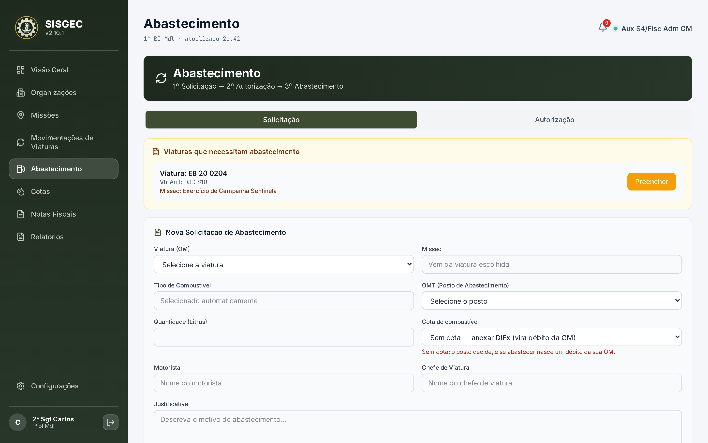
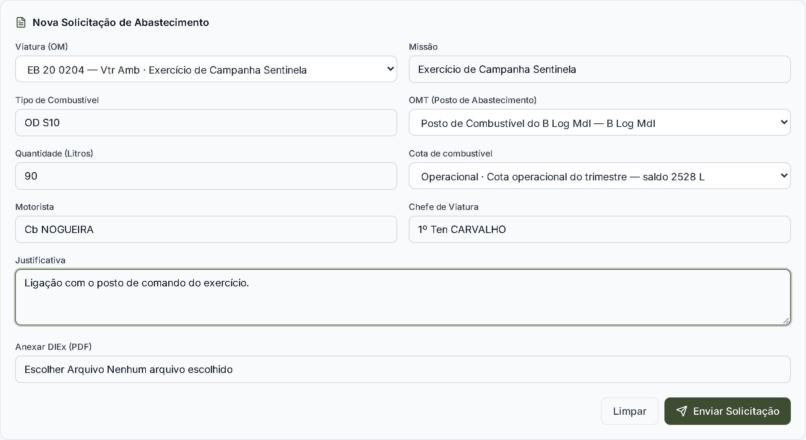
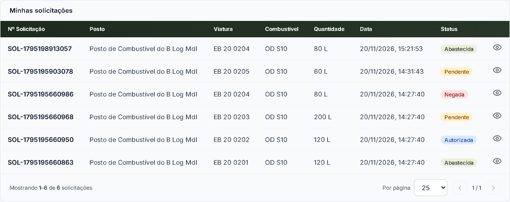
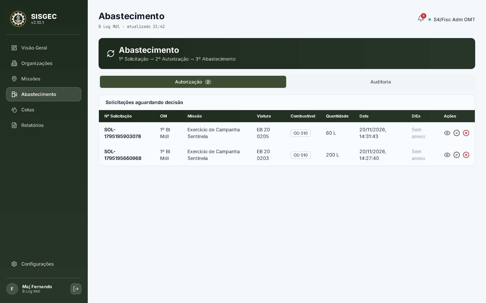
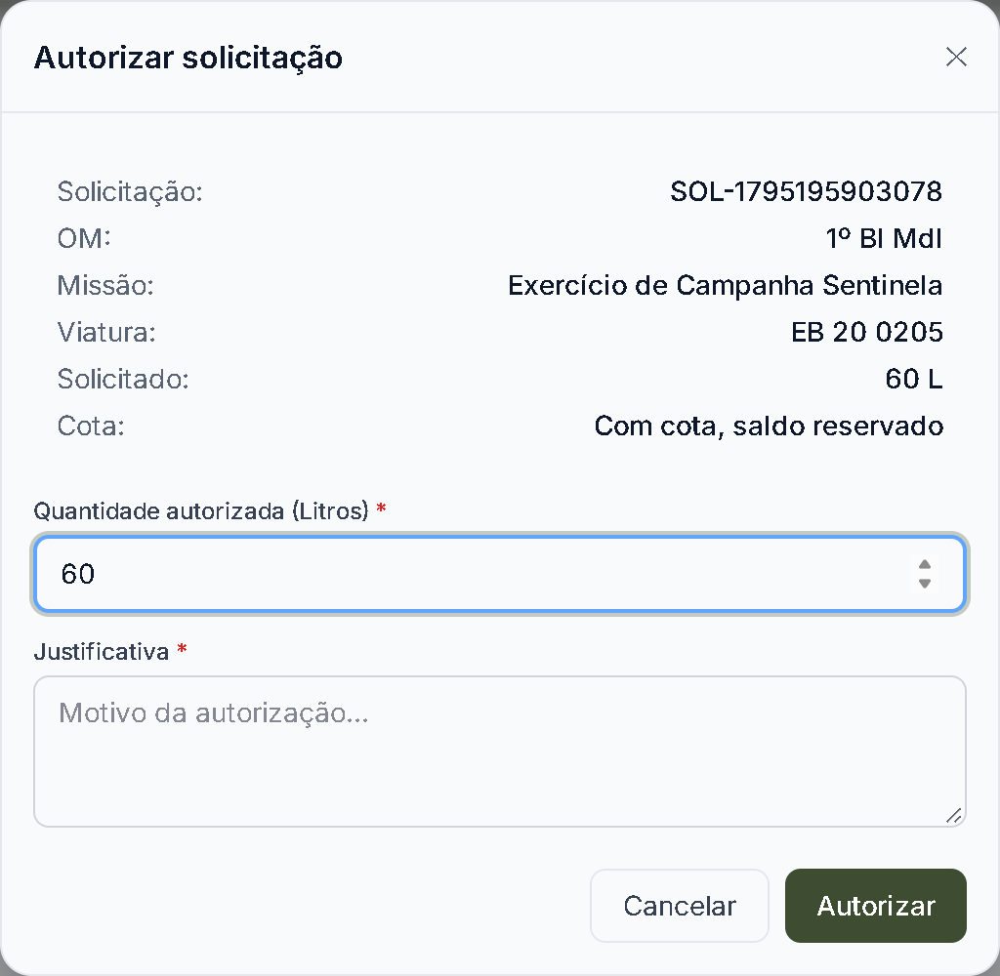
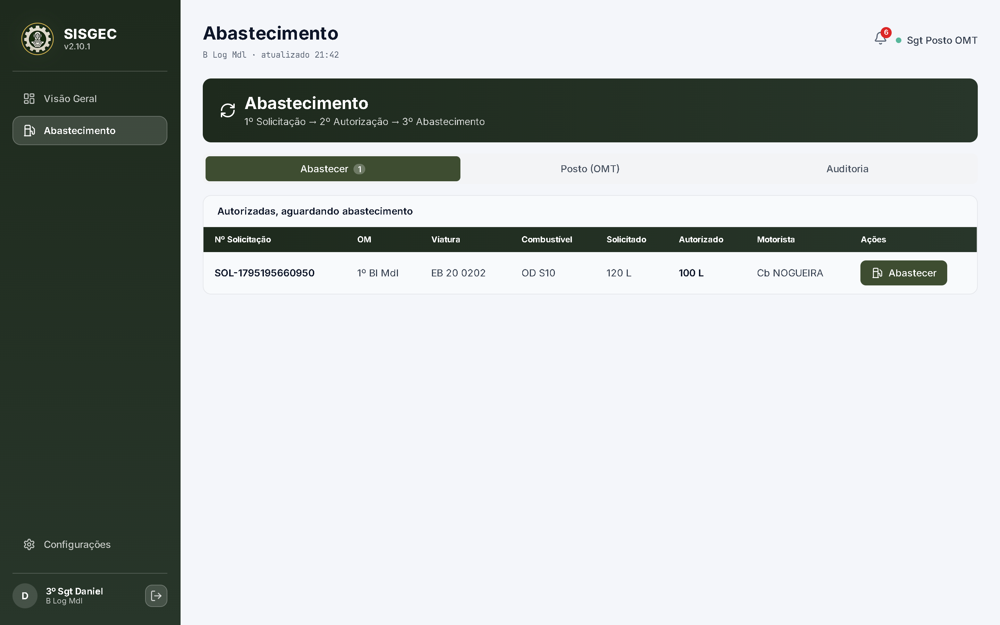
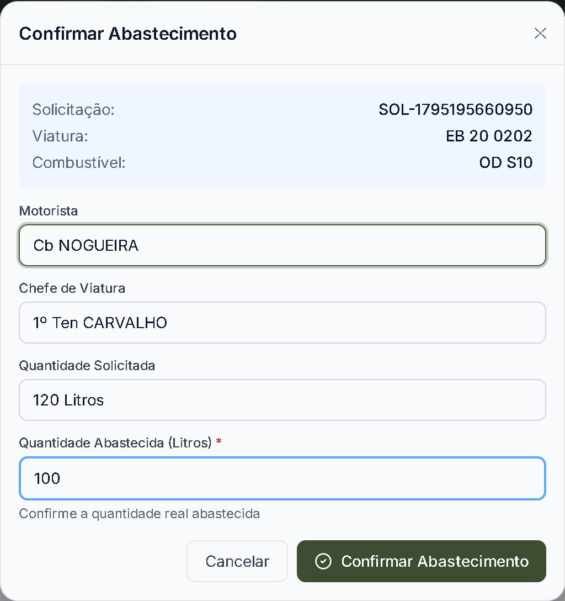
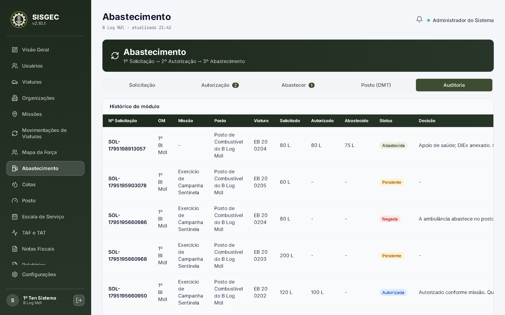

# Abastecimento

O módulo controla o combustível do pedido até a bomba, em três etapas feitas por pessoas diferentes:

**1º Solicitação** (OM que precisa) → **2º Autorização** (OM dona do posto) → **3º Abastecimento** (quem opera a bomba)

Cada etapa fica registrada com nome, data e hora. O estoque do posto só baixa na terceira, com a quantidade que realmente saiu da bomba.

> [!NOTE]
> Ao final deste capítulo, o usuário saberá:
>
> - pedir combustível para uma viatura de missão;
> - autorizar ou negar um pedido, ajustando a quantidade;
> - registrar o abastecimento feito;
> - consultar o histórico completo na aba Auditoria.

## 1. Quem faz o quê

| Aba | Quem usa (perfil padrão) | O que faz |
|---|---|---|
| Solicitação | S4 e Aux S4 da OM | Pede combustível para uma viatura |
| Autorização | S4 e Aux S4 da OM dona do posto | Autoriza ou nega, com justificativa |
| Abastecer | Sgt do Posto, Of Dia e Adjunto | Confirma a quantidade abastecida |
| Posto (OMT) | Lado do posto | Lançamento por ficha e fechamento mensal |
| Auditoria | Quem fiscaliza | Histórico de todos os pedidos |

Cada pessoa só vê as abas do seu perfil.

> [!WARNING]
> **SEGREGAÇÃO DE FUNÇÕES**
>
> **Quem pediu não autoriza nem abastece o próprio pedido**, nem mesmo o Administrador do Sistema. Assim uma pessoa sozinha não consegue percorrer o ciclo inteiro.

## 2. Solicitar combustível (1º)

O quadro amarelo **Viaturas que necessitam abastecimento** lista as viaturas que:

- estão numa **missão aprovada** com a opção "necessita abastecimento" marcada;
- ainda estão no pátio;
- não têm pedido em aberto.

Viatura de missão apenas planejada, ou que já saiu, não aparece. Isso amarra todo pedido a uma missão.

**Passo a passo**

1. Clique em **Preencher** na viatura. Missão e tipo de combustível vêm sozinhos.
2. Escolha o **posto** (OMT) onde vai abastecer.
3. Informe a **quantidade** em litros.
4. Escolha a **cota** que o pedido vai consumir. O sistema mostra o saldo de cada uma.
5. Preencha **motorista**, **chefe de viatura** e **justificativa**.
6. Clique em **Enviar Solicitação**.

> [!WARNING]
> **SEM COTA**
>
> Sem cota, é obrigatório anexar o **DIEx** do pedido de apoio, em PDF. Se o posto abastecer, nasce um **débito** da sua OM, que aparece no módulo Cotas até ser coberto com uma cota nova.

Ao enviar, o S4, o Aux S4 e o Sargento do posto recebem um aviso no sino. O pedido entra na lista **Minhas solicitações** como **Pendente**.

| Situação | Significado |
|---|---|
| Pendente | Aguardando a decisão do posto |
| Autorizada | Liberada; aguardando a bomba |
| Negada | Recusada, com o motivo. Corrija e peça de novo |
| Abastecida | Concluída; o estoque do posto já baixou |

## 3. Autorizar ou negar (2º)

Feita pela OM **dona do posto**. A aba mostra o número de pedidos aguardando decisão.

1. Clique no **olho** para ver o pedido completo.
2. Clique no **✓ verde** para autorizar ou no **✗ vermelho** para negar.
3. Ao autorizar, confira a **quantidade autorizada**. Ela pode ser **menor** que a pedida, nunca maior.
4. Escreva a **justificativa**. Ela é obrigatória nos dois casos.
5. Confirme.

A OM que pediu é avisada da decisão no sino.

> [!NOTE]
> **POR QUE AUTORIZAR MENOS**
>
> Quem autoriza conhece o saldo do tanque. O sistema guarda os três números do ciclo (**pedido**, **autorizado** e **abastecido**) em separado, e nenhum apaga o outro.

## 4. Registrar o abastecimento (3º)

Feito por quem opera a bomba: Sargento do Posto ou, fora do expediente, o Oficial de Dia e o Adjunto.

1. Na aba **Abastecer**, localize o pedido. A coluna **Autorizado** é o teto.
2. Clique em **Abastecer**.
3. Informe a **quantidade real** que saiu da bomba. Pode ser menor que a autorizada, porque o tanque da viatura enche antes.
4. Clique em **Confirmar Abastecimento**.

Na confirmação, o sistema:

- baixa o estoque do posto e grava o movimento (saldo anterior e saldo novo);
- recusa quantidade acima da autorizada;
- recusa abastecer se o tanque não tiver saldo, porque o estoque nunca fica negativo;
- avisa a OM que pediu.

## 5. Auditoria

A aba **Auditoria** mostra todos os pedidos, em qualquer situação, com os três números lado a lado (solicitado, autorizado e abastecido) e a justificativa da decisão. O olho abre o registro completo, com as datas de cada etapa.

## 6. Vídeo

O vídeo [`abastecimento-solicitacao.webm`](../videos/abastecimento-solicitacao.webm) mostra uma solicitação do início ao fim (cerca de 30 s).

## 7. Resumo

> [!TIP]
> - Todo pedido nasce de uma **missão aprovada**.
> - **Com cota** basta pedir. **Sem cota**, anexe o DIEx, e o abastecimento vira débito.
> - O posto pode **autorizar menos**, nunca mais, e justifica sempre.
> - A bomba registra o **real**, até o autorizado, e só aí o estoque baixa.
> - **Quem pede não autoriza nem abastece.**
