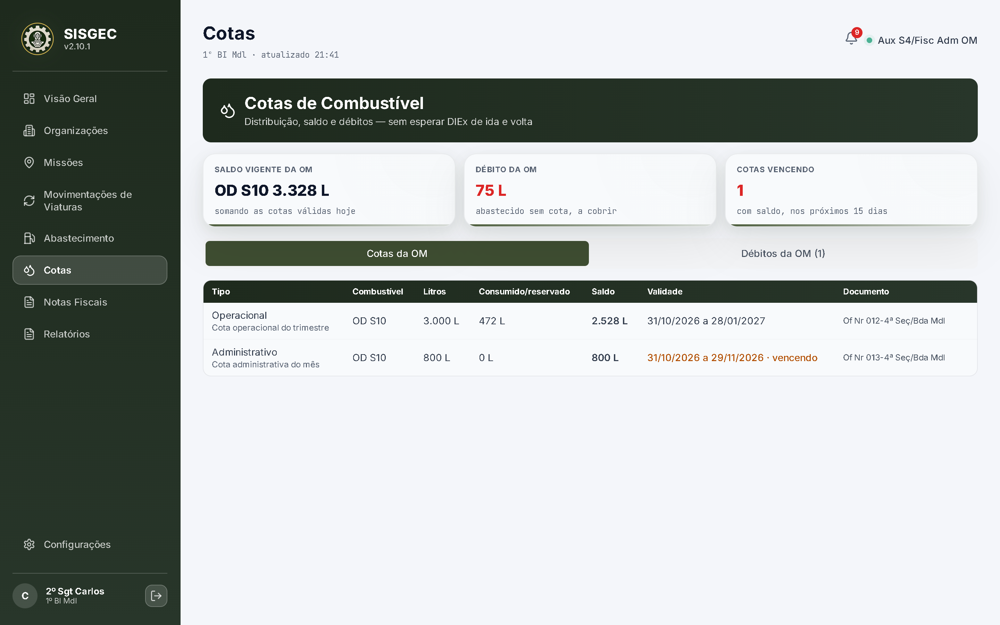
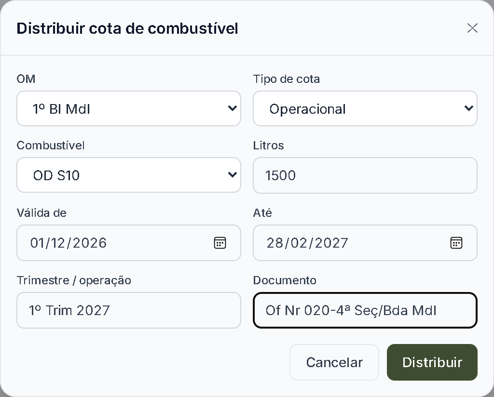
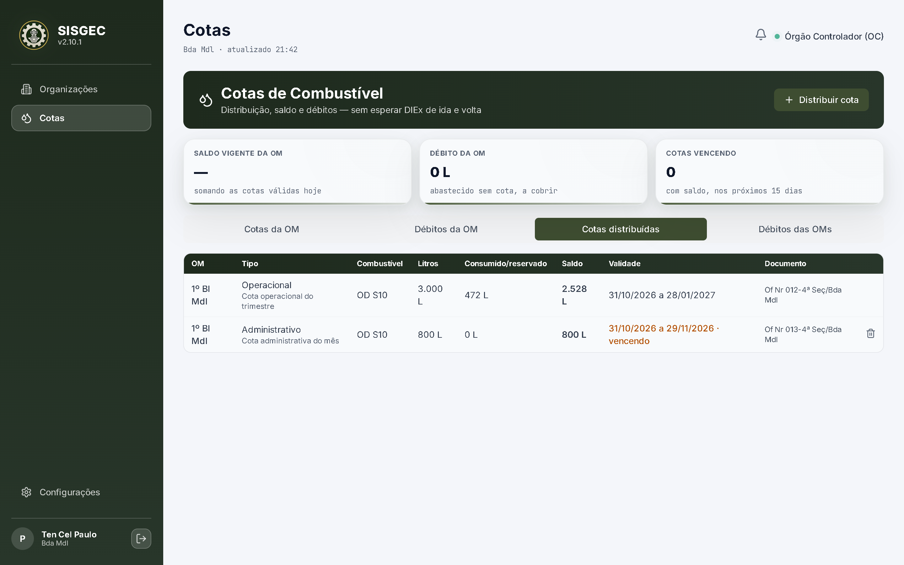
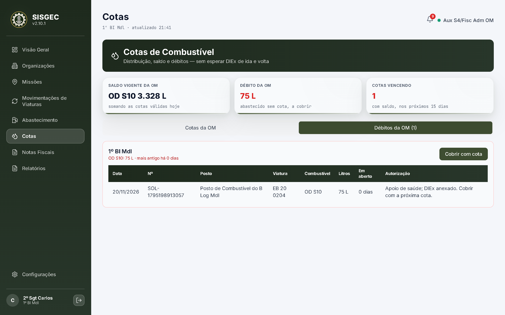
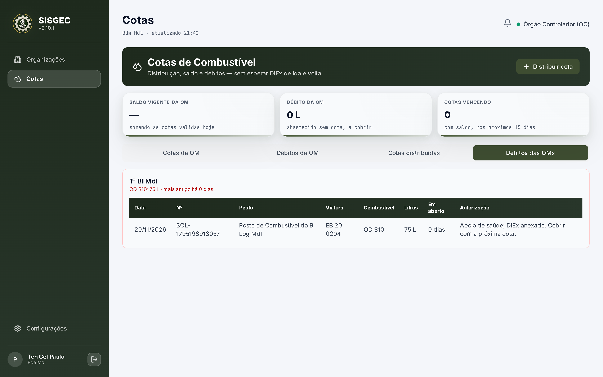
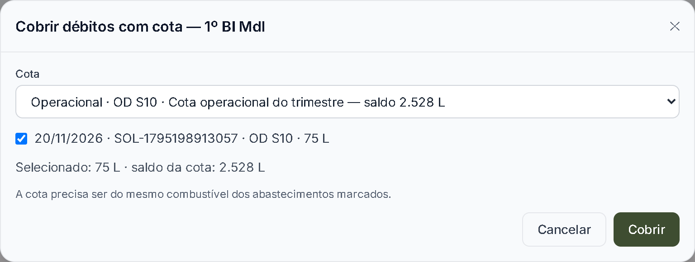

# Cotas

A cota é o combustível a que cada OM tem direito, distribuído pelo seu **Órgão Controlador (OC)**. Ela vale em qualquer posto. O pedido de abastecimento já nasce consumindo uma cota (Capítulo 7). O que for abastecido **sem cota** vira **débito** da OM, até ser coberto por uma cota nova.

> [!NOTE]
> Ao final deste capítulo, o usuário saberá:
>
> - consultar as cotas da OM e o saldo de cada uma;
> - distribuir cota às OMs subordinadas (Órgão Controlador);
> - entender como nasce um débito;
> - cobrir um débito com uma cota.

## 1. Quem usa

| Quem | O que faz |
|---|---|
| S4 e Aux S4 da OM | Consultam as cotas e os débitos da OM e cobrem os débitos |
| Órgão Controlador (OC) | Distribui as cotas e acompanha os débitos das OMs dele |
| Posto onde se abasteceu | Também pode cobrir o débito que ficou no seu posto |

O OC de cada OM é definido no cadastro da OM, em Organizações (Capítulo 3).

## 2. As cotas da OM

No alto, três indicadores:

| Indicador | O que mostra |
|---|---|
| Saldo vigente da OM | Soma do saldo das cotas válidas hoje, por combustível |
| Débito da OM | Litros abastecidos sem cota e ainda não cobertos |
| Cotas vencendo | Cotas com saldo que vencem nos próximos 15 dias |

A tabela mostra cada cota: tipo, combustível, litros, **consumido/reservado**, **saldo**, validade e documento. Cota fora da validade aparece esmaecida. Cota vencendo com saldo é destacada: é combustível a que a OM tem direito e está perdendo.

> [!NOTE]
> **O SALDO É RESERVADO NO PEDIDO**
>
> O saldo cai quando a OM **pede**, não quando abastece. Assim, dois pedidos não contam com o mesmo litro. O saldo é sempre calculado na hora, a partir dos pedidos, e nunca digitado.

## 3. Distribuir cota (Órgão Controlador)

1. Clique em **Distribuir cota**.
2. Escolha a **OM**. A lista traz só as OMs que têm a sua como Órgão Controlador, e basta o módulo Cotas para vê-la (não é preciso acesso a Organizações).
3. Escolha o **tipo de cota** (Administrativo, Operacional, Transporte, Apoio Logístico, Trânsito, Ensino, Manutenção, Apoio Saúde, Inteligência ou SFPC) e o **combustível**.
4. Informe os **litros** e a **validade** (de/até).
5. Preencha o **trimestre ou operação** e o **documento** que autoriza a cota.
6. Clique em **Distribuir**.

O S4 e o Aux S4 da OM recebem o aviso no sino, com os litros e a validade.

Na aba **Cotas distribuídas**, o OC vê as cotas que lançou para cada OM. A lixeira só aparece em cota **sem uso nenhum**, para corrigir lançamento errado. Cota já usada é histórico e não sai.

## 4. Como nasce um débito

Pode acontecer de a OM precisar de combustível sem ter cota com saldo. Nesse caso:

1. Ao pedir o abastecimento, escolha **Sem cota** e anexe o **DIEx** do pedido de apoio (obrigatório).
2. O posto decide como em qualquer pedido. Na autorização, quem decide vê que o pedido é **sem cota**.
3. Quando a bomba confirma o abastecimento, nasce o **débito**. O S4 e o Aux S4 da OM são avisados na hora, sem esperar o posto cobrar.

A aba **Débitos da OM** agrupa o que está em aberto: data, número, posto, viatura, combustível, litros, **dias em aberto** e a justificativa da autorização. O OC acompanha os mesmos débitos na aba **Débitos das OMs**, ordenados pelo mais antigo.

## 5. Cobrir o débito

Assim que chegar uma cota, a própria OM cobre o débito, sem DIEx de ida e volta.

1. Na aba **Débitos da OM**, clique em **Cobrir com cota**.
2. Escolha a **cota**. Aparecem só as cotas vigentes com saldo.
3. Marque os **abastecimentos** que essa cota vai cobrir.
4. Confira o total selecionado contra o saldo da cota.
5. Clique em **Cobrir**.

> [!WARNING]
> **TUDO OU NADA**
>
> A cota precisa ser **da mesma OM**, do **mesmo combustível** e estar **válida hoje**. O total marcado não pode passar do saldo dela. Se um dos abastecimentos não servir, nenhum é coberto.

O posto onde se abasteceu também pode cobrir, pela lista de débitos da aba **Posto (OMT)**, no módulo Abastecimento. Quando é a OM que cobre, o posto é avisado. O débito só some da lista quando estiver coberto por uma cota.

## 6. Resumo

> [!TIP]
> - A cota vem do **Órgão Controlador** e vale em **qualquer posto**.
> - O saldo é **reservado no pedido** e calculado na hora.
> - **Sem cota**, o pedido exige DIEx, e o abastecimento vira **débito**.
> - O débito é coberto pela **própria OM**, com cota do mesmo combustível, válida e com saldo.
> - Só cota **sem uso** pode ser excluída, e só por quem a distribuiu.
