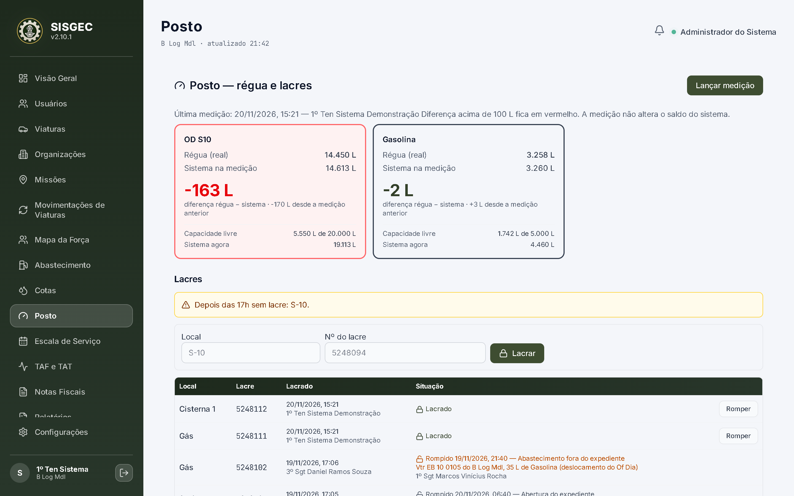
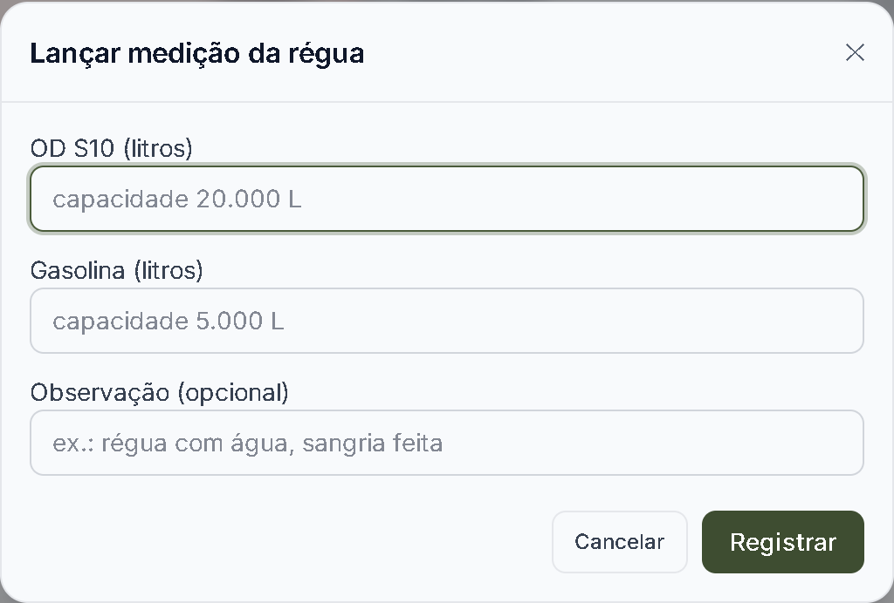
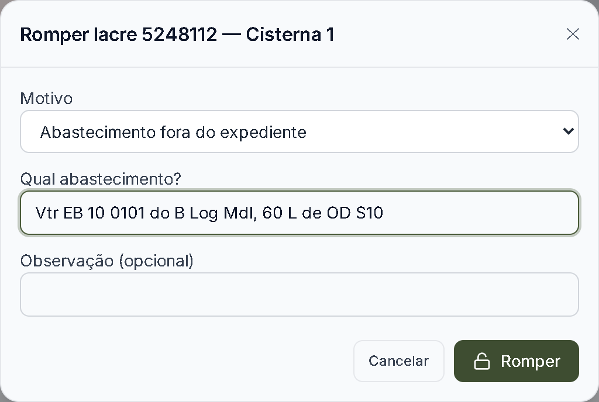

# Posto

O módulo é o **quadro branco do posto** dentro do sistema: a **régua diária** de cada tanque, comparada com o saldo que o sistema calcula, e o **livro de lacres** dos tanques e cisternas.

> [!NOTE]
> Ao final deste capítulo, o usuário saberá:
>
> - lançar a medição da régua e ler a diferença para o sistema;
> - lacrar um tanque no fim do expediente;
> - romper um lacre, inclusive fora do expediente;
> - entender os alertas de lacre.

## 1. Quem usa

Só a **OM dona do posto** registra régua e lacres nele. Na matriz de permissões, o módulo tem duas linhas: **consultar régua e lacres** e **medir régua, lacrar e romper lacre**. Quem mede, lacra e rompe é o Sargento do Posto e, à noite, o Adjunto ao Oficial de Dia, que abastece fora do expediente.

Se a OM tiver mais de um posto, um seletor no alto da tela escolhe qual.

## 2. O quadro do posto

A tela tem três partes: os cartões de cada combustível, os **lacres** e o **histórico da régua**.

Cada cartão mostra:

| Campo | Significado |
|---|---|
| Régua (real) | O que foi medido no tanque |
| Sistema na medição | O saldo que o sistema calculava no mesmo instante |
| Diferença | Régua menos sistema |
| Variação | Quanto a diferença mudou desde a medição anterior |
| Capacidade livre | Quanto ainda cabe no tanque |
| Sistema agora | O saldo atual, depois dos abastecimentos seguintes |

> [!WARNING]
> **DIFERENÇA ACIMA DE 100 L**
>
> Diferença de **100 litros ou mais**, para mais ou para menos, deixa o cartão **vermelho**. Abaixo disso é a variação normal de leitura da régua.

> [!NOTE]
> **A MEDIÇÃO SÓ REGISTRA**
>
> Lançar a régua **não muda o saldo** do sistema. A diferença também vem de abastecimento ainda não lançado e da própria leitura. Ajustar o saldo é decisão do administrador, à parte.

## 3. Lançar a medição da régua

1. Clique em **Lançar medição**.
2. Informe os **litros** de cada combustível do posto. O campo mostra a capacidade do tanque.
3. Se precisar, escreva uma **observação** (por exemplo, "régua com água, sangria feita").
4. Clique em **Registrar**.

É preciso informar pelo menos um combustível. O sistema recusa valor negativo ou acima da capacidade do tanque. A medição entra no **histórico da régua**, com régua, sistema, diferença e quem mediu.

## 4. Lacrar

No fim do expediente, cada local do posto é lacrado.

1. No quadro **Lacres**, informe o **local** (S-10, S-500, Gás, Cisterna 1...). O campo sugere os locais já usados.
2. Informe o **número do lacre**.
3. Clique em **Lacrar**.

Cada local tem **um lacre ativo por vez**. Para lacrar de novo, rompa o anterior.

## 5. Romper o lacre

1. Na linha do lacre, clique em **Romper**.
2. Escolha o **motivo**:
    - **Abertura do expediente**: de manhã, quando ninguém abasteceu à noite;
    - **Abastecimento fora do expediente**: à noite, informando **qual abastecimento** (viatura, OM e litros);
    - **Troca de lacre** ou **Outro**.
3. Se precisar, escreva uma **observação**.
4. Clique em **Romper**.

> [!WARNING]
> **FORA DO EXPEDIENTE**
>
> Antes das 6h ou depois das 17h, quem decide o horário é o relógio do servidor, não o motivo escolhido:
>
> - "Abertura do expediente" é recusado;
> - "Abastecimento fora do expediente" exige dizer qual abastecimento;
> - qualquer outro motivo exige a observação.

## 6. Alertas de lacre

Os alertas aparecem em amarelo no alto do quadro de lacres:

- **depois das 17h**, os locais que ainda estão **sem lacre**;
- todo lacre **rompido fora do expediente** nas últimas 24 horas, com o motivo e o abastecimento informado, para conferência.

A tabela de lacres mostra, para cada um: local, número, quando e por quem foi lacrado e a situação (lacrado, ou rompido com data, motivo e responsável).

## 7. Resumo

> [!TIP]
> - A régua é comparada com o sistema no **mesmo instante**. Diferença de **100 L ou mais** fica vermelha.
> - A medição **não altera** o saldo do sistema.
> - **Um lacre ativo por local**. Para lacrar de novo, rompa antes.
> - Fora do expediente, quem rompe **diz por quê**, e o rompimento entra nos alertas.
