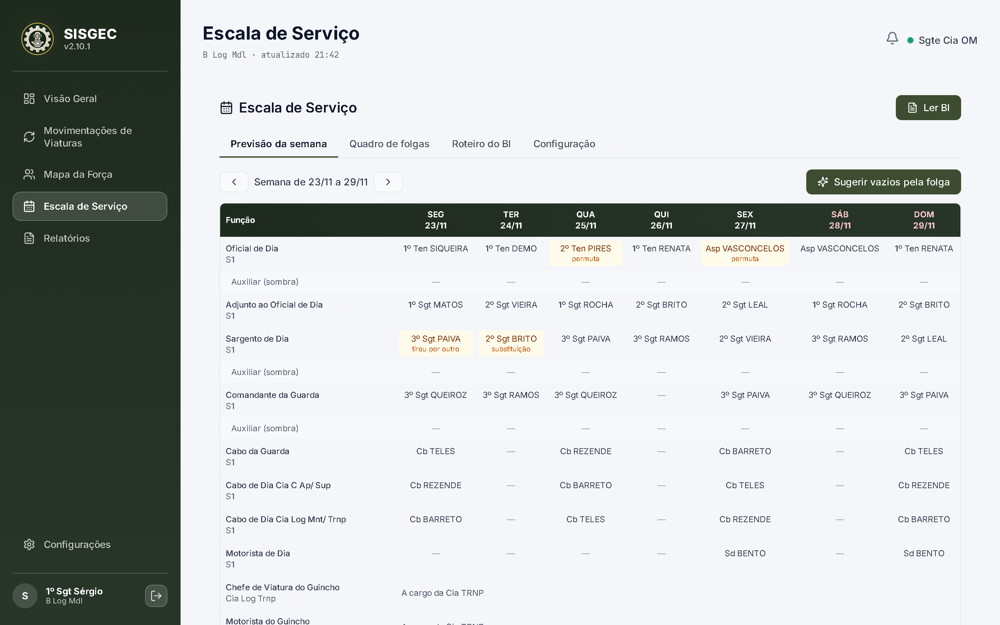
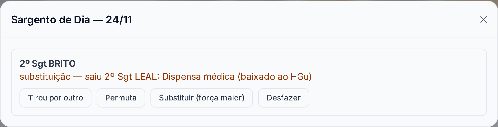
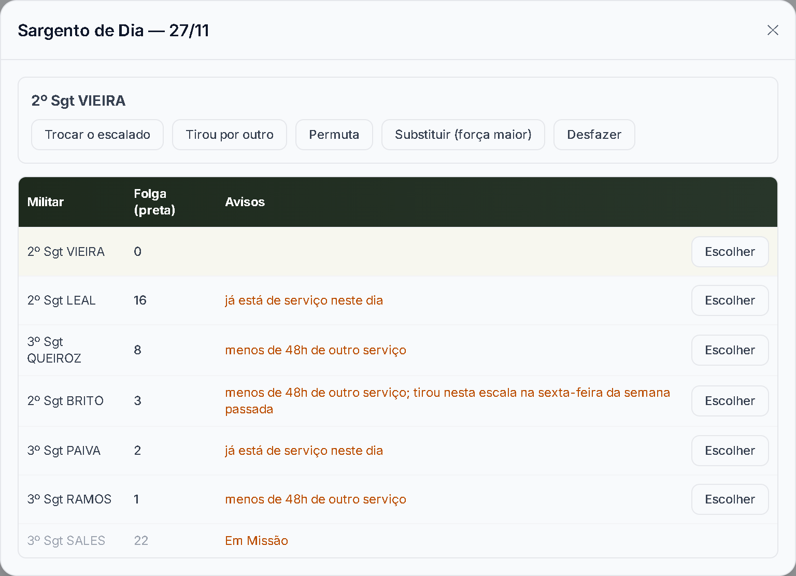
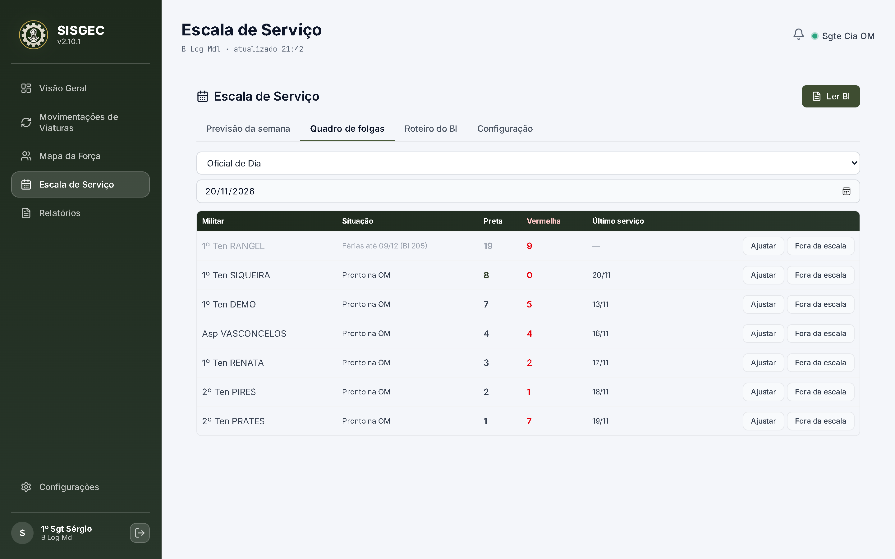
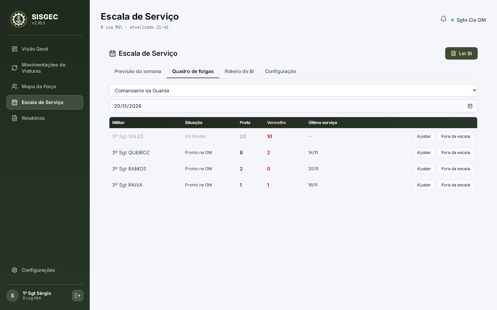
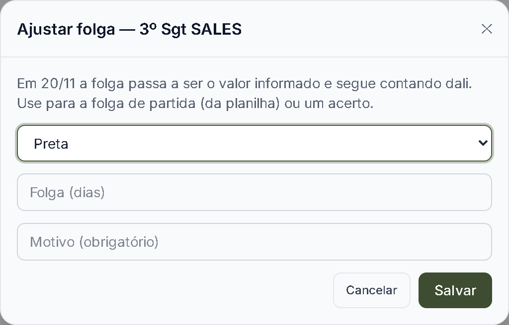
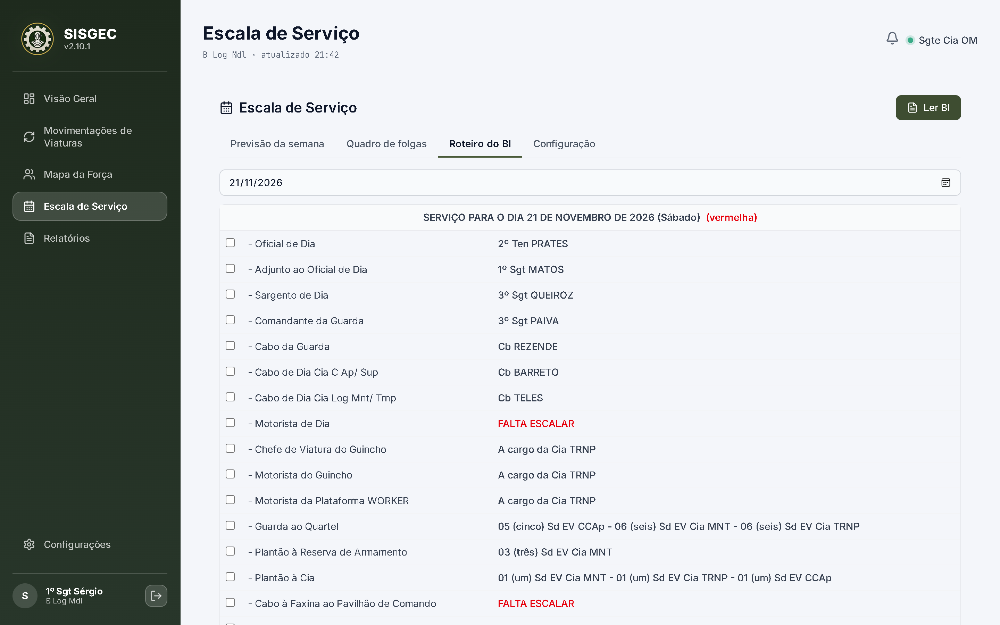
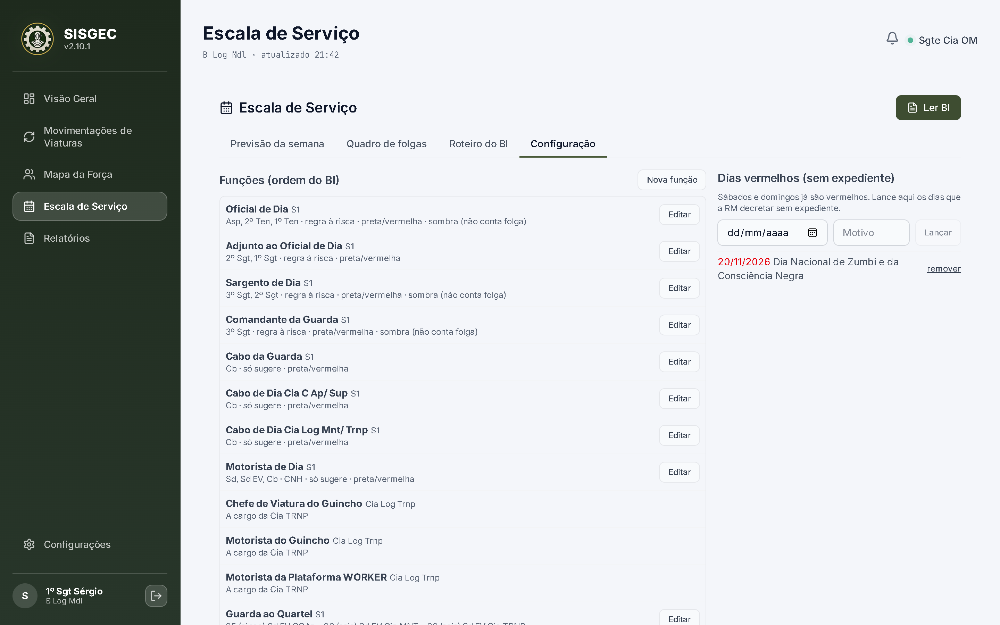

# Escala de Serviço

O módulo monta a "Escala de Serviços Internos" do BI: quem tira cada serviço em cada dia, pelo quadro de folgas e pelas regras do RISG. O sistema sugere, avisa e registra as alterações. Quem decide é o responsável pela escala.

> [!NOTE]
> Ao final deste capítulo, o usuário saberá:
>
> - ler a previsão da semana e escalar um militar;
> - registrar "tirou por outro", permuta e substituição;
> - ler e ajustar o quadro de folgas (preta e vermelha);
> - lançar a escala no BI com o roteiro;
> - saber quem altera cada escala.

> [!WARNING]
> **A ESCALA NÃO É PÚBLICA**
>
> Só quem tem a permissão do módulo vê a escala. Não existe página aberta nem consulta sem login. As telas deste capítulo usam militares fictícios.

## 1. Quem consulta e quem altera

Todos os que têm acesso ao módulo **veem todas as escalas**. Cada escala, porém, só é **alterada pelo seu responsável**:

| Responsável | Quem altera |
|---|---|
| S1 | A S1 e os auxiliares (escalas do BI: Oficial de Dia, Adjunto, Sargento de Dia…) |
| Cia (CCAp, Cia Log Mnt, Sup, Trnp…) | O Sargenteante da Cia e seus auxiliares |
| Todas | O Administrador do Sistema |

O que liga a pessoa à escala é o campo **"Escala de Serviço: altera a escala de"**, no cadastro do usuário (Capítulo 1). Só o Administrador define esse campo. Quem não é o responsável abre a escala e só consulta.

São **só da S1**: lançar dias vermelhos, criar funções e mudar quem concorre a cada uma (tipo, P/G, Cia, CNH) e quem responde por ela.

Na primeira vez, a S1 clica em **Criar as funções do BI**. O sistema cadastra as funções da escala de serviços internos, na ordem do BI.

## 2. Previsão da semana

A grade mostra uma semana, de segunda a domingo. Use as setas para mudar de semana.

| O que se vê | Significado |
|---|---|
| Dia com cabeçalho vermelho | Dia vermelho: sábado, domingo ou dia sem expediente lançado pela S1 |
| Coluna destacada | O dia de hoje |
| Célula amarela | Serviço com alteração: tirou por outro, permuta ou substituição |
| — | Sem ninguém escalado |
| Auxiliar (sombra) | Linha do auxiliar, nas funções que têm sombra |
| "A cargo da Cia…" | Função que o BI só cita, sem nome |

### Sugerir pela folga

O botão **Sugerir vazios pela folga** preenche os titulares vazios da semana, de hoje em diante, **só nas escalas que você altera**. Ele segue a regra: maior folga, sem quem não está pronto, sem quem já está de serviço no dia e sem quem tirou na véspera. **Não mexe no que já está escalado.** Quando não há ninguém livre, avisa quais vagas ficaram sem candidato.

## 3. Escalar e alterar um serviço

Clique numa célula. Se estiver vazia, abre a lista de candidatos. Se já tiver alguém, abre o serviço com as ações.

| Ação | Quando usar | Efeito na folga |
|---|---|---|
| Trocar o escalado | Corrigir a escolha antes de qualquer alteração | Passa a contar para o novo escalado |
| Tirou por outro | A tira no lugar de B, combinado entre os dois | **A folga continua sendo de B** (RISG) |
| Permuta | Dois militares trocam de dia | **A folga não muda**: cada um segue contando a sua |
| Substituir (força maior) | Dispensa médica, missão, imprevisto, inclusive com o serviço em curso | Quem entra conta o serviço; quem saiu não conta e volta para a frente da fila |
| Desfazer | Apagar um serviço | Só em dia que ainda não passou |

A **substituição exige o motivo**. Nas outras ações, a observação é opcional.

Quem entra no serviço passa pelas mesmas conferências de quem é escalado, em qualquer das ações:

- **Dois serviços no mesmo dia** são sempre recusados, em qualquer escala (RISG): tirar por outro, substituir ou permutar não pode deixar alguém de serviço duas vezes na mesma data.
- Na **permuta**, cada um dos dois é conferido no dia novo: precisa estar pronto e, nas escalas de regra à risca, respeitar as 48h e o vício de dia. Nas demais, o que for só aviso aparece na tela depois de permutar.
- Em **tirou por outro** e **substituir**, menos de 48h de outro serviço continua sendo só aviso.
- Na lista de candidatos para trocar, o próprio escalado do dia não aparece mais como "já está de serviço neste dia".

### Os candidatos

A lista vem em ordem: primeiro quem pode, sem avisos, da **maior para a menor folga**. Para escalar, clique em **Escolher**.

| Aviso (em laranja) | O que quer dizer |
|---|---|
| já está de serviço neste dia | Tem outro serviço na mesma data |
| menos de 48h de outro serviço | Tirou na véspera ou tira no dia seguinte |
| tirou nesta escala na … da semana passada | Vício: o mesmo militar no mesmo dia da semana |

Quem aparece **em cinza não concorre** naquele dia, e o motivo vem ao lado: situação diferente de "Pronto na OM" no Mapa da Força, férias, dispensa ou licença publicada em BI, deslocamento no QSGR, ou apresentação no próprio dia (só concorre no dia seguinte).

> [!NOTE]
> **REGRA À RISCA × SÓ SUGERE**
>
> Nas funções marcadas como **regra à risca** (Oficial e Sargento), o sistema **recusa** escalar quem tem aviso. Para escalar mesmo assim quem tem menos de 48h, use **Substituir** e informe o motivo; quem já está de serviço no dia não entra por nenhum caminho. Nas demais (Cabo e Soldado), o aviso **não bloqueia**, com uma exceção: dois serviços no mesmo dia são recusados também ali.

## 4. Quadro de folgas

Escolha a **função** e a **data**. O quadro mostra, para cada militar do P/G daquela função:

| Coluna | Significado |
|---|---|
| Situação | Pronto na OM, ou o motivo de estar fora (férias até…, Em Missão…) |
| Preta | Folga dos dias de expediente |
| Vermelha | Folga dos dias vermelhos |
| Último serviço | Data do último serviço nesta função |

A maior folga entre quem pode concorrer aparece em verde: é quem sai primeiro.

**Como a folga conta**

- A **preta** cresce 1 por dia corrido, **inclusive de férias ou em missão** (3 dias + 30 de férias = 34).
- A **vermelha** cresce 1 a cada dia vermelho que passa.
- Serviço em dia preto zera a preta. Serviço em dia vermelho zera a vermelha.
- Na **escala corrida**, para efetivo reduzido, a folga é uma só, sem cor.
- **Empate:** sai o de menor P/G. Entre iguais, sai o mais moderno: praça mais recente e, na mesma praça, o mais novo.
- Quem **nunca tirou** naquela função vem antes de todos, para todo mundo rodar uma vez antes de alguém repetir.

**Ajustar** registra a folga de partida, vinda da planilha antiga, ou um acerto. A partir da data escolhida, a folga passa ao valor informado e segue contando. O **motivo é obrigatório**.

**Fora da escala** tira o militar daquela função sem mexer no Mapa da Força. É o caso do médico com o P/G de Oficial de Dia. **Voltar à escala** desfaz.

## 5. Roteiro do BI

O sistema do BI não aceita colar texto. O roteiro mostra, **na ordem do formulário do BI**, o que lançar em cada função no dia escolhido (por padrão, amanhã).

1. Escolha a data. O título sai como no BI: "SERVIÇO PARA O DIA …", com "(vermelha)" quando for o caso.
2. Lance cada função no sistema do BI e **marque a caixa** dela. A marcação fica só neste navegador.
3. **FALTA ESCALAR**, em vermelho, aponta a função sem ninguém escalado.

Nas funções com várias vagas, o nome sai como no aditamento: número e nome de guerra. As alterações aparecem ao lado do nome.

## 6. Configuração

À esquerda ficam as **funções**, na ordem do BI, com o resumo de cada uma: vagas por dia, Cia, P/G que concorrem, CNH, "regra à risca" ou "só sugere", "corrida" ou "preta/vermelha", e se tem sombra que conta folga ou não.

| Tipo de função | Como aparece |
|---|---|
| Militar escalado | Nome por dia, pela folga |
| A cargo da Cia | Texto fixo ("A cargo da Cia TRNP") |
| Efetivo por Cia | Texto fixo com o efetivo ("05 (cinco) Sd EV CCAp…") |

À direita ficam os **dias vermelhos**. Sábado e domingo já são vermelhos. A S1 lança os dias sem expediente decretados (feriado, ponto facultativo) com o motivo, e remove se for o caso.

## 7. Resumo

> [!TIP]
> - Todos com acesso **consultam**. Cada escala é **alterada só pelo responsável** (S1 ou Cia).
> - **Sugerir** preenche os vazios pela folga, sem mexer no que já está escalado.
> - **Tirou por outro** e **permuta** não mudam a folga. Na **substituição**, quem entra conta o serviço, e o motivo é obrigatório.
> - Ninguém fica com **dois serviços no mesmo dia**, seja por escala, troca, permuta ou substituição.
> - Quem está de **férias, dispensa, missão ou deslocado** não concorre, pela mesma regra do Mapa da Força.
> - O **Roteiro do BI** dá a ordem exata do lançamento no BI.
