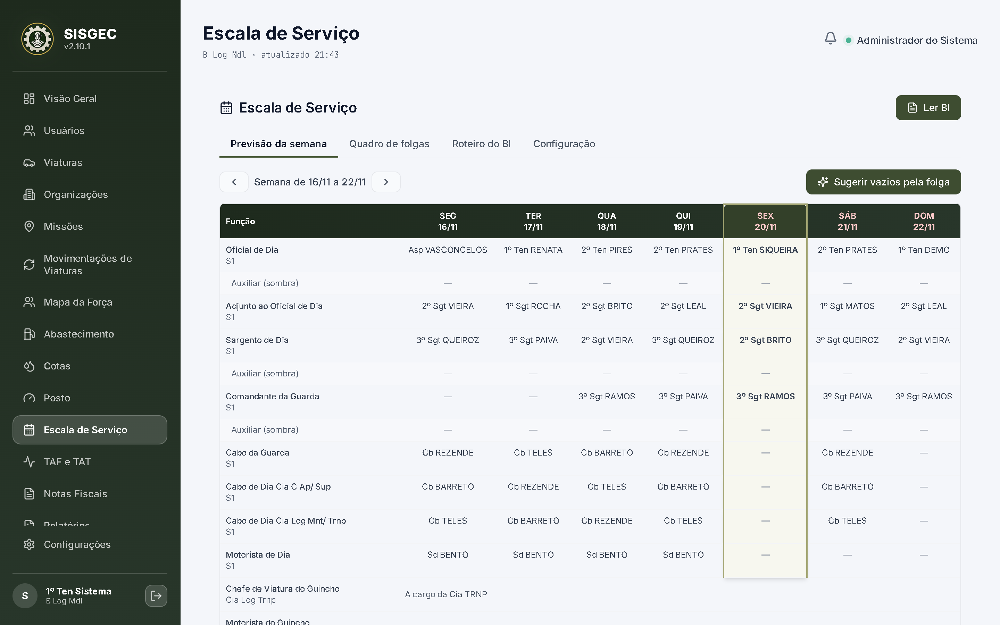
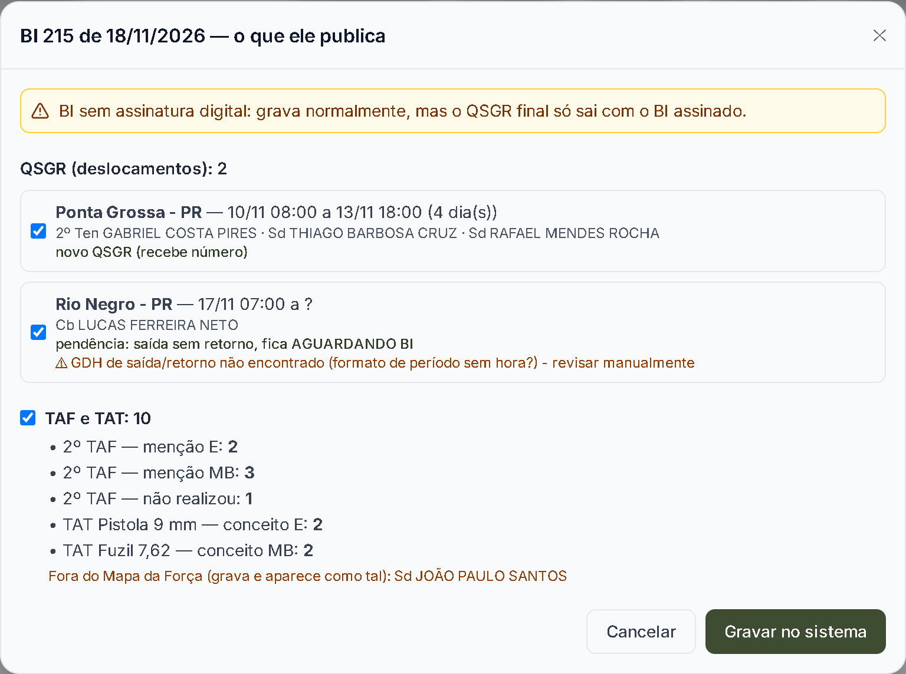
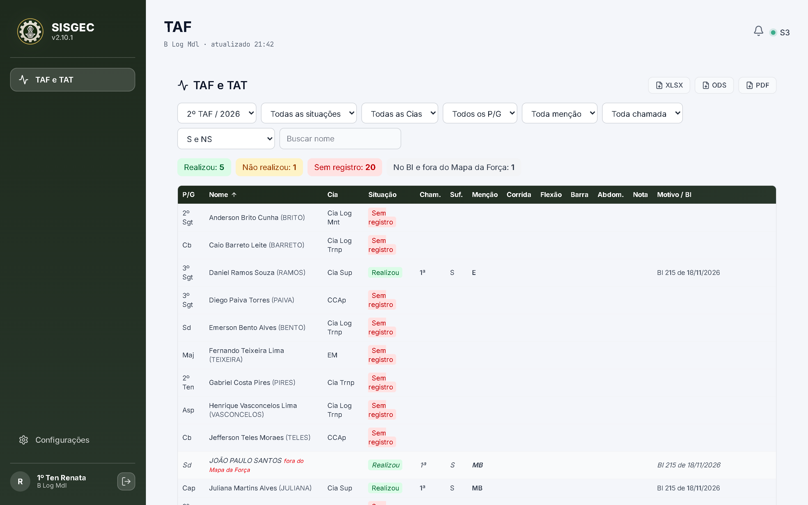
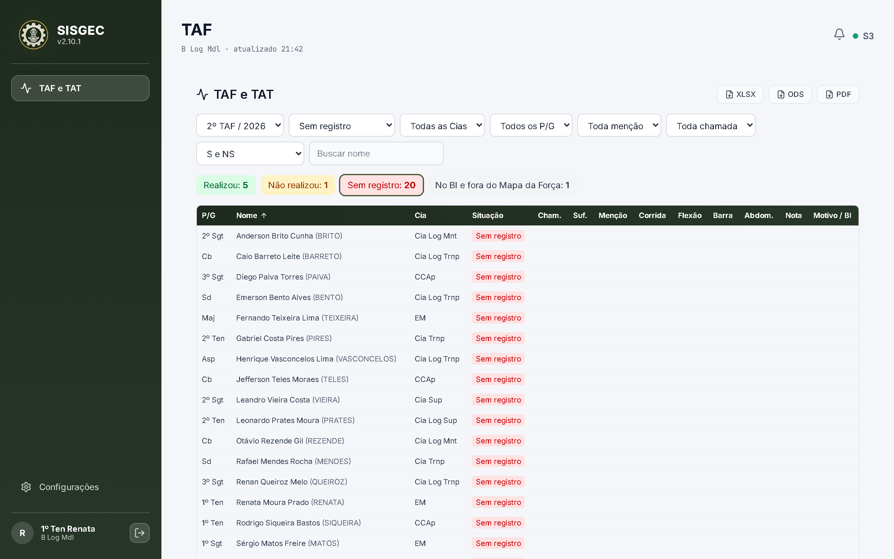
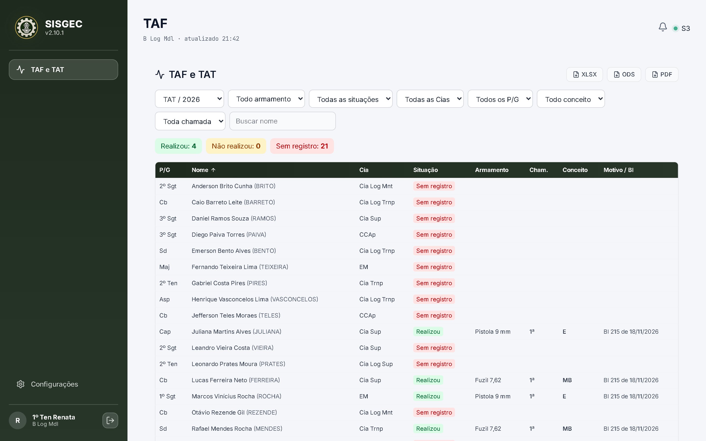

# TAF e TAT

O módulo cruza o **Mapa da Força** com o que os Boletins Internos publicam sobre o **TAF** (Teste de Avaliação Física) e o **TAT** (Teste de Aptidão no Tiro). O quadro mostra quem realizou, com chamada, suficiência e menção ou conceito; quem não realizou, com o motivo publicado; e quem ainda está sem registro.

Ninguém digita resultado. Eles entram pelo **BI**, lido uma vez pela S1, e o sistema separa o que é de cada módulo.

> [!NOTE]
> Ao final deste capítulo, o usuário saberá:
>
> - como os resultados do BI chegam ao módulo;
> - ler o quadro de um TAF e do TAT;
> - achar quem ainda não fez o teste;
> - emitir o relatório em XLSX, ODS ou PDF.

## 1. Quem usa

| Quem | O que faz |
|---|---|
| S1 (usuário com "Escala de: S1") ou Administrador | Lê o BI em **Escala de Serviço → Ler BI** e grava os resultados |
| S3 e Aux S3 (perfil padrão) | Consulta o quadro e emite o relatório |

## 2. Os resultados entram pelo BI

1. Em **Escala de Serviço**, clique em **Ler BI** e escolha o PDF do boletim. Um BI digitalizado leva até um minuto, porque o sistema lê a imagem.
2. O sistema mostra, módulo por módulo, o que o BI publica, **sem gravar nada**.
3. Na parte **TAF e TAT**, confira os grupos e clique em **Gravar no sistema**.

A conferência agrupa os resultados (por exemplo, "2º TAF — menção E: 2" ou "TAT Pistola 9 mm — conceito E: 2"). Também lista quem aparece no BI e **não está no Mapa da Força**: essa pessoa é gravada assim mesmo e aparece no quadro em itálico, marcada "fora do Mapa da Força".

> [!NOTE]
> **O QUE O LEITOR ENTENDE**
>
> - "Realizou ... a 1ª Chamada do 2º Teste de Avaliação Física ... Suficiência "S" e a Menção "E"", seguido da lista de militares;
> - o TAF **alternativo** (subtítulo "2º TAF ALTERNATIVO" ou a observação "TAF Alternativo, Menção ...");
> - o DIEx transcrito no BI, com a menção de cada militar;
> - "Deixou de realizar o 2º TAF/26 por ..." — guarda o motivo;
> - o TAF **formativo** do CFC, com os índices (idade, corrida, flexão, barra, abdominal e nota);
> - o **TAT** por armamento ("Pistola 9 mm - Realização"), com o conceito no lugar da menção;
> - "Torno sem efeito a Nota ..." apaga o que aquele BI tinha lançado;
> - na retificação, vale só o "Leia-se"; o "Onde se lê" é ignorado.

Ler o mesmo BI de novo **não duplica**: o que veio dele é substituído.

## 3. O quadro do TAF

1. No primeiro seletor, escolha o teste: **1º, 2º ou 3º TAF**, **CFC (formativo)** ou **TAT**, de cada ano.
2. Os cartões coloridos resumem o quadro: **Realizou**, **Não realizou**, **Sem registro** e, quando houver, **No BI e fora do Mapa da Força**. Clique num cartão para filtrar por ele; clique de novo para limpar.
3. Refine pelos filtros: situação, companhia, posto, menção, chamada, suficiência (S ou NS) e nome.
4. Clique no título de uma coluna para ordenar. Clicar de novo inverte a ordem.

| Coluna | O que mostra |
|---|---|
| Situação | Realizou, Não realizou ou Sem registro |
| Cham. / Suf. / Menção | A chamada, a suficiência e a menção publicadas; "I" e "NS" saem em vermelho |
| Corrida a Nota | Os índices, quando o BI os publica (ex.: CFC) |
| Motivo / BI | O motivo de não ter realizado e o BI de origem. Passe o mouse para ver todas as chamadas do militar |

> [!NOTE]
> **QUAL RESULTADO VALE**
>
> Se o militar tem mais de um registro no mesmo TAF, **"realizou" vale sobre "não realizou"** e, entre os realizados, vale a **última chamada**.

## 4. Quem ainda não fez

O cartão **Sem registro** lista o efetivo do Mapa da Força sem nada publicado naquele teste. É a lista de cobrança da próxima chamada. No CFC (formativo) só entra quem fez parte do curso.

## 5. O TAT

Escolha **TAT / ano** no primeiro seletor. Aparece o filtro **Armamento** e a coluna **Conceito** (E, MB, B, R ou I). Quem atirou com mais de uma arma aparece com o último resultado; o filtro de armamento separa os dois.

## 6. Relatório

Os botões **XLSX**, **ODS** e **PDF** emitem o quadro **com os mesmos filtros e a mesma ordem da tela**: posto, nome, companhia, situação, chamada, menção ou conceito, índices e o motivo ou BI.

## 7. Resumo

> [!TIP]
> - O resultado entra **pelo BI**, lido pela S1 em Escala de Serviço → Ler BI.
> - Nada é gravado antes de conferir; ler de novo **substitui**, não duplica.
> - O quadro cruza o BI com o **Mapa da Força**: Realizou, Não realizou e Sem registro.
> - "Realizou" vale sobre "não realizou"; vale a última chamada.
> - O relatório sai igual à tela, em XLSX, ODS ou PDF.
