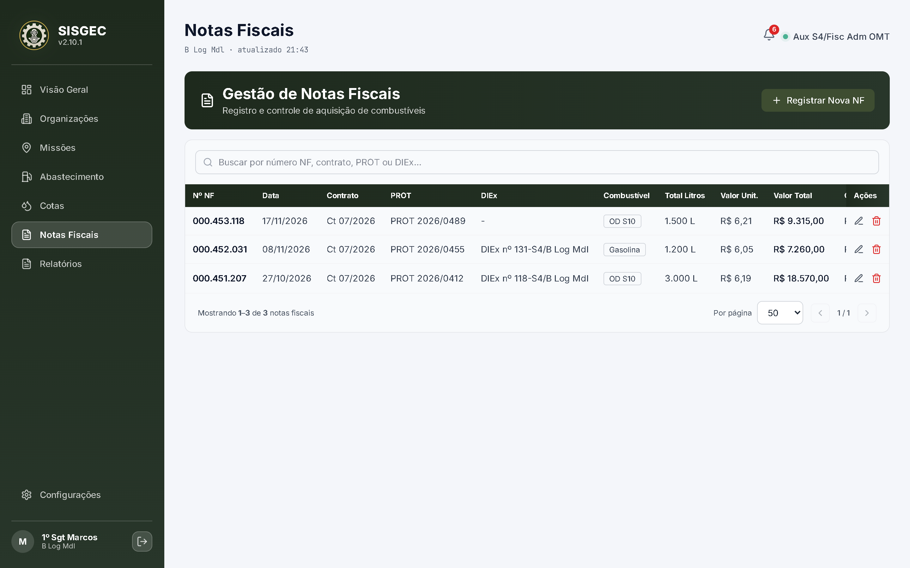
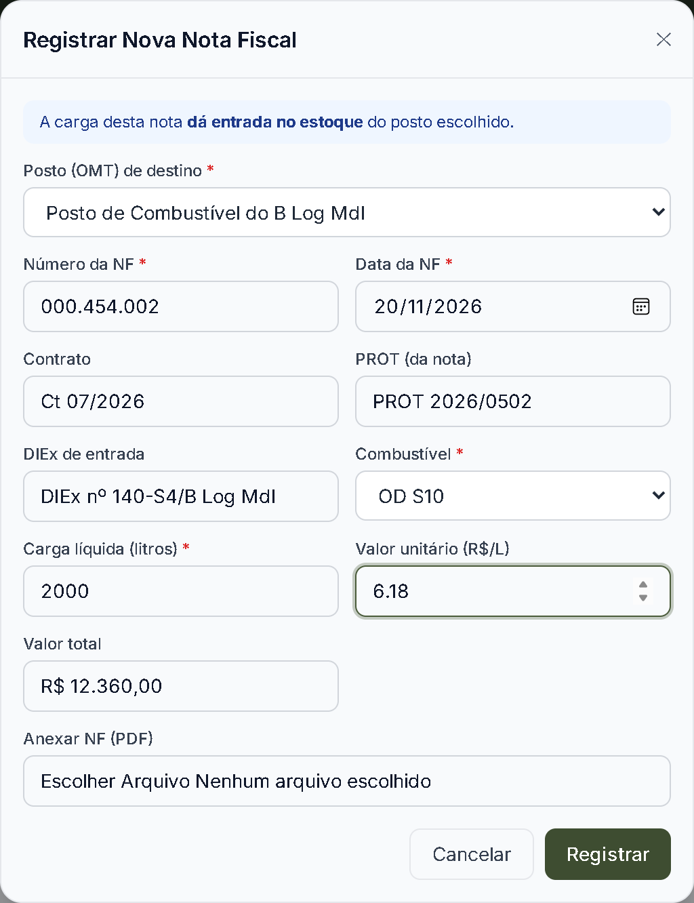
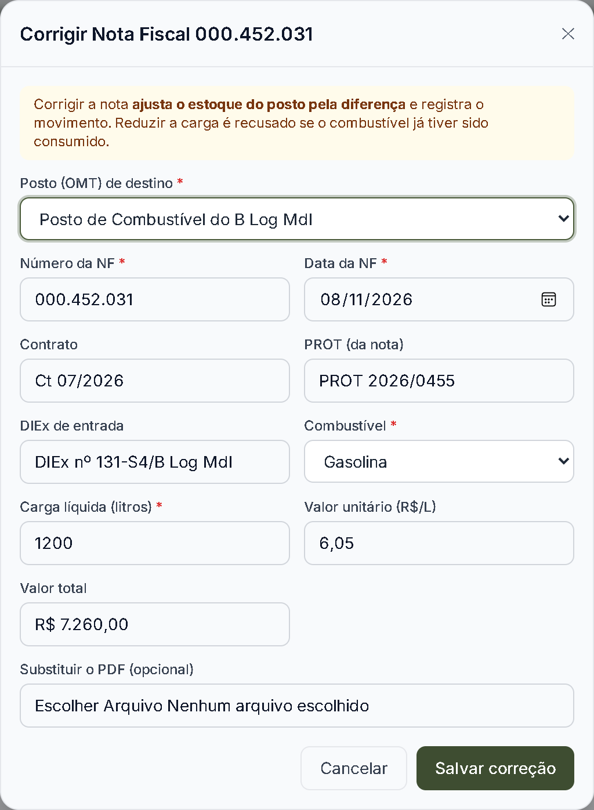
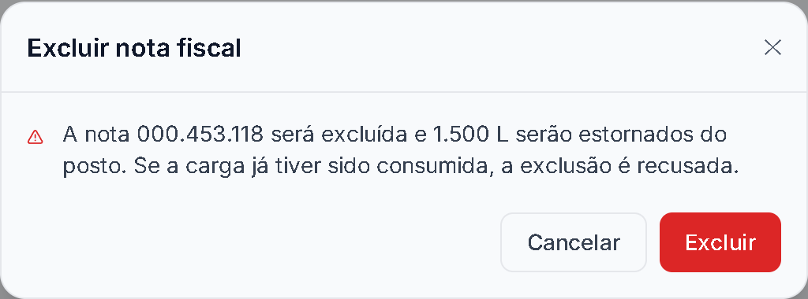

# Notas Fiscais

Toda entrada de combustível no posto acontece por **nota fiscal**. Registrar a nota é o que soma os litros ao estoque do posto, e é desse estoque que o Abastecimento tira (Capítulo 7).

> [!NOTE]
> Ao final deste capítulo, o usuário saberá:
>
> - registrar uma nota fiscal e anexar o PDF;
> - corrigir uma nota já lançada sem desacertar o estoque;
> - excluir uma nota e o que acontece com os litros;
> - buscar notas por número, contrato, PROT ou DIEx.

## 1. A lista de notas

As notas aparecem da mais recente para a mais antiga, com número, data, contrato, PROT, DIEx, combustível, litros, valor unitário, valor total, o posto de destino e o PDF anexado. São doze colunas: quando não cabem na largura da tela, a tabela rola para o lado e a coluna **Ações** fica fixa à direita, sempre visível.

- A **busca** procura por número da NF, contrato, PROT e DIEx, em todas as notas da OM.
- **Abrir**, na coluna PDF, mostra o documento anexado. "Sem anexo" indica que a nota foi lançada sem o arquivo.

| Ícone | Ação |
|---|---|
| Lápis | Corrigir a nota e ajustar o estoque |
| Lixeira | Excluir a nota e estornar a carga |

## 2. Registrar uma nota

1. Clique em **Registrar Nova NF**.
2. Escolha o **posto (OMT) de destino**. Só aparecem os postos da sua OM.
3. Preencha **número** e **data** da NF.
4. Informe **contrato**, **PROT** e **DIEx de entrada**, se houver.
5. Escolha o **combustível** e a **carga líquida** em litros.
6. Informe o **valor unitário**. O **valor total** é calculado sozinho.
7. Anexe o **PDF** da nota e clique em **Registrar**.

Os campos com **\*** são obrigatórios: posto, número, data, combustível e carga líquida.

> [!WARNING]
> **A NOTA MEXE NO ESTOQUE**
>
> Ao registrar, a carga **entra no estoque** do posto escolhido, e o movimento fica gravado com saldo anterior e saldo novo. O sistema recusa a nota quando:
>
> - o número já foi registrado na mesma OM;
> - a entrada passaria da **capacidade** do tanque daquele combustível;
> - o anexo não é um PDF de verdade (o sistema confere o conteúdo, não só o nome do arquivo).

## 3. Corrigir uma nota

1. Clique no **lápis** da nota.
2. Corrija o que estiver errado. O PDF fica vazio: sem novo arquivo, o anexo atual é mantido.
3. Clique em **Salvar correção**.

O estoque é ajustado na mesma hora, sempre com registro do movimento:

| O que mudou | O que o sistema faz |
|---|---|
| Só os litros | Aplica a **diferença** (ex.: de 1.000 para 1.200 L, entram 200 L) |
| O posto ou o combustível | Estorna do posto e combustível antigos e dá entrada no novo |
| Nada nos litros | O saldo do posto fica igual |

Reduzir a carga é recusado se o combustível já tiver sido consumido. Ao trocar o PDF, o arquivo antigo não é apagado: é documento fiscal.

## 4. Excluir uma nota

A exclusão **estorna** do posto os litros que a nota deu entrada. Se esse combustível já saiu da bomba, o estorno deixaria o saldo negativo, e o sistema **recusa a exclusão**. O saldo do posto nunca fica negativo.

## 5. Resumo

> [!TIP]
> - Combustível só **entra** no posto por nota fiscal.
> - Registrar a nota **soma** ao estoque, até a capacidade do tanque.
> - Corrigir ajusta o estoque **pela diferença**, com registro do movimento.
> - Excluir **estorna** a carga, e é recusado se o combustível já foi consumido.
> - O número da NF é único por OM, e o anexo precisa ser PDF.
