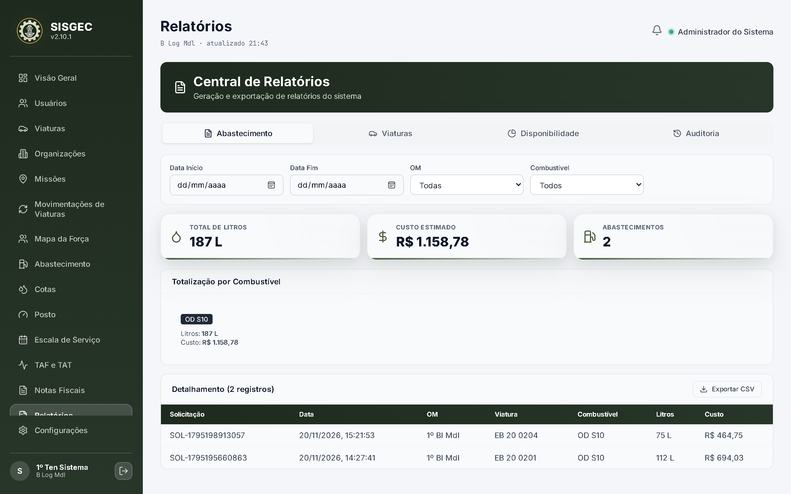
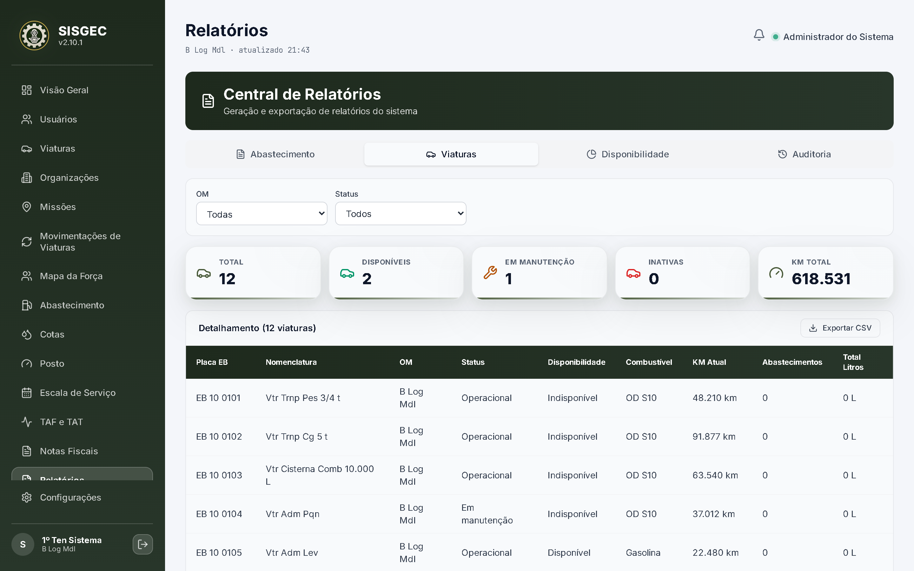
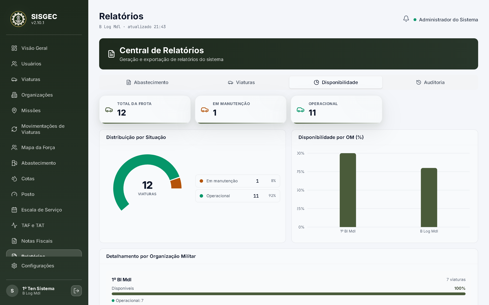
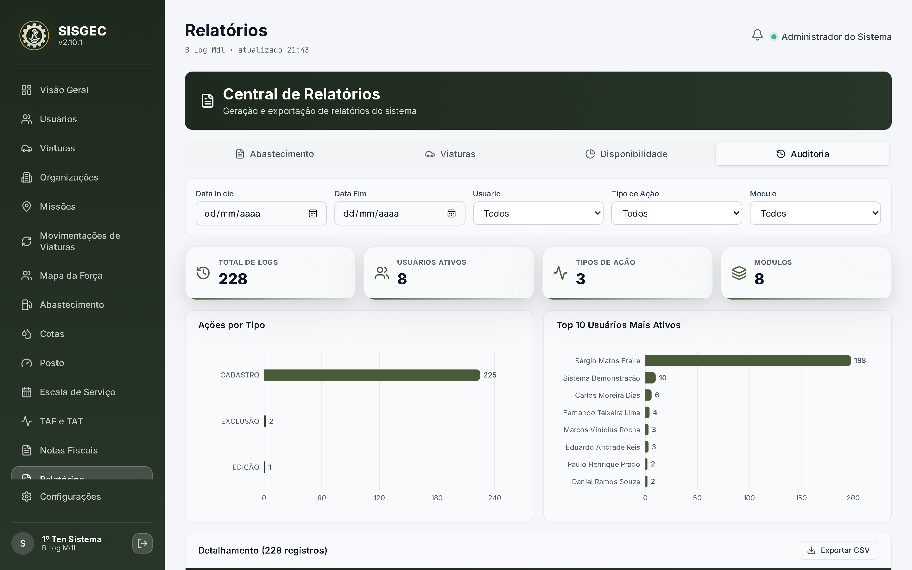

# Relatórios

A **Central de Relatórios** junta os números do sistema em quatro abas: consumo de combustível, frota, disponibilidade e a trilha de auditoria. Todas têm filtros, e as tabelas de detalhe exportam para CSV, que abre no Excel ou no LibreOffice.

> [!NOTE]
> Ao final deste capítulo, o usuário saberá:
>
> - tirar o relatório de consumo, de frota e de disponibilidade;
> - filtrar e exportar cada relatório;
> - consultar a trilha de auditoria: quem fez o quê, e quando;
> - entender como a trilha é gravada.

## 1. As quatro abas

| Aba | Filtros | O que mostra |
|---|---|---|
| Abastecimento | Datas, OM, combustível | Consumo efetivo e custo estimado |
| Viaturas | OM, status | A frota e o consumo de cada viatura |
| Disponibilidade | Nenhum | Situação da frota por OM |
| Auditoria | Datas, usuário, tipo de ação, módulo | A trilha de tudo que foi alterado |

Cada usuário vê os números da **sua OM**. O Administrador do Sistema vê todas. A aba **Auditoria** só aparece para quem tem o módulo **Auditoria** na matriz de permissões (Capítulo 1): ter Relatórios não basta para ler quem fez o quê.

## 2. Abastecimento

Entram só os pedidos já **abastecidos** (Capítulo 7). Pedido pendente, autorizado ou negado não é consumo.

- **Total de Litros**, **Custo Estimado** e **Abastecimentos**: os totais do período filtrado.
- **Totalização por Combustível**: litros e custo de cada tipo (OD S10, OD S500, Gasolina).
- **Detalhamento**: um registro por abastecimento, com solicitação, data, OM, viatura, combustível, litros e custo.

O custo é **estimado**: os litros multiplicados pelo preço médio das notas fiscais de cada combustível (Capítulo 12).

## 3. Viaturas

Os cartões contam a frota: total, disponíveis, em manutenção, inativas e a quilometragem somada. O detalhamento traz cada viatura com placa, nomenclatura, OM, status, disponibilidade, combustível, quilometragem atual, número de abastecimentos e total de litros.

## 4. Disponibilidade

Mostra a frota pela situação: um gráfico com a **distribuição por situação**, o **percentual disponível de cada OM** e a tabela por organização militar.

## 5. Auditoria: a trilha

Toda alteração feita no sistema vira uma linha nesta trilha: cadastro, edição, exclusão e ações como aprovar, autorizar ou abastecer.

| Cartão ou painel | O que conta |
|---|---|
| Total de Logs | Todos os registros do filtro, sem limite |
| Usuários Ativos | Quantas pessoas aparecem no filtro inteiro |
| Tipos de Ação | Quantos tipos diferentes (cadastro, edição, exclusão) |
| Módulos | Em quantos módulos houve alteração |
| Ações por Tipo | Gráfico por tipo de ação |
| Top 10 Usuários Mais Ativos | Quem mais alterou no período |

O **detalhamento** traz data e hora, usuário, tipo, módulo e uma descrição gerada da própria operação, como "Executou 'aprovar' em Missões (registro 12)". A tabela mostra os **1.000 registros mais recentes** do filtro; os cartões e gráficos, não: contam o filtro inteiro. Para ver na tabela registros mais antigos, filtre por datas, usuário ou módulo.

> [!WARNING]
> **A TRILHA É DO SERVIDOR**
>
> Quem grava a trilha é o servidor, não a tela. O autor vem da sessão de quem fez a operação e o endereço vem da conexão: ninguém registra ação em nome de outro, e uma operação feita por fora da tela também fica registrada. Só entram as operações **concluídas**. Tentativa recusada não aparece aqui.

O tipo de ação segue a operação:

| Tipo | Quando |
|---|---|
| CADASTRO | Criar um registro ou executar uma ação sobre ele (aprovar, autorizar, abastecer) |
| EDIÇÃO | Alterar um registro |
| EXCLUSÃO | Excluir um registro |

Ficam fora da trilha, de propósito, a troca de tema da tela e a marcação de aviso como lido. As alterações da matriz de permissões têm registro próprio, com a descrição do que mudou.

## 6. Exportar

Cada tabela de detalhe tem o botão **Exportar CSV**. O arquivo traz exatamente as linhas e colunas que estão na tela, com os filtros aplicados.

## 7. Resumo

> [!TIP]
> - Quatro relatórios: **abastecimento**, **viaturas**, **disponibilidade** e **auditoria**.
> - O consumo conta só o que foi **abastecido**; o custo usa o **preço médio das notas fiscais**.
> - A trilha é gravada pelo **servidor**, com o autor da sessão: não dá para forjar nem pular.
> - Cada um vê a **sua OM**; o Administrador vê todas.
> - Toda tabela de detalhe **exporta para CSV**.
