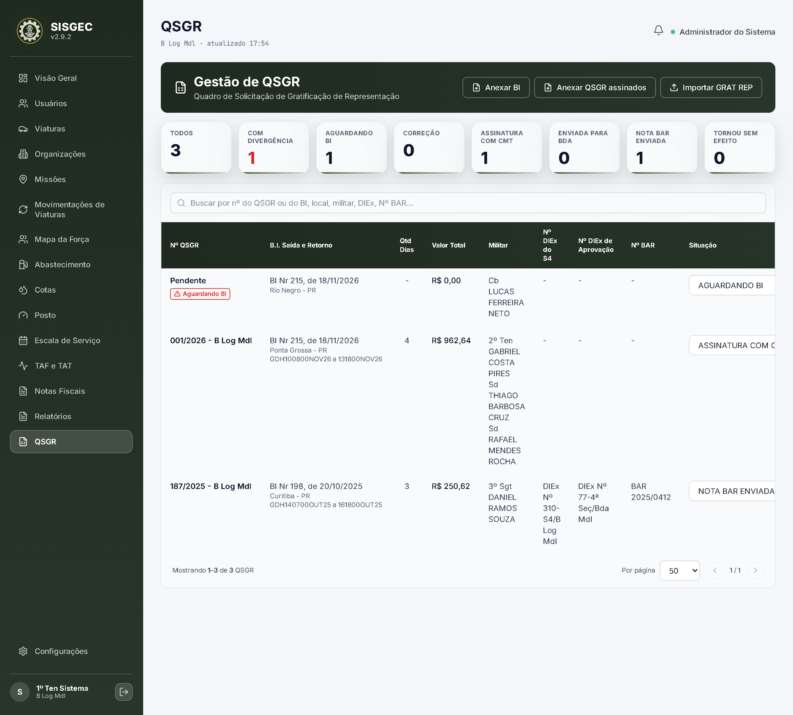
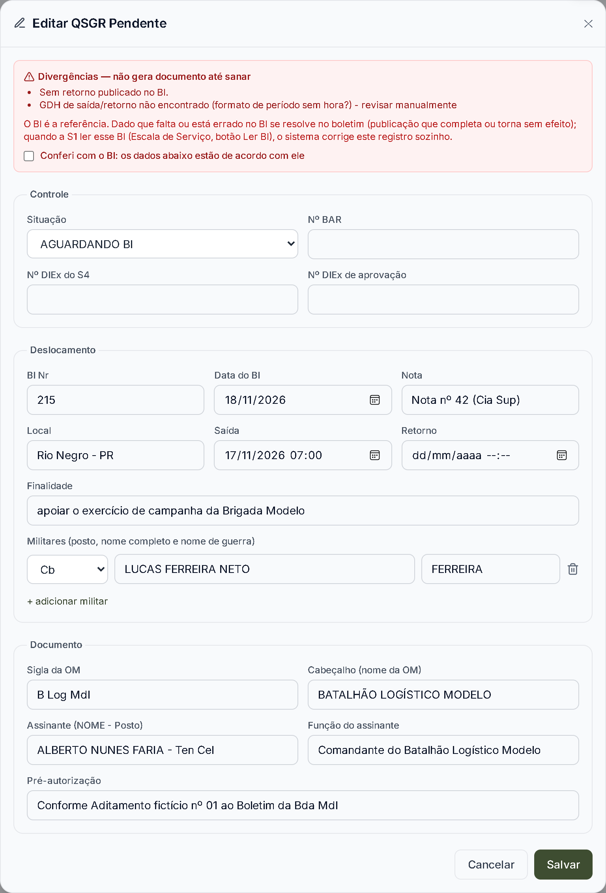
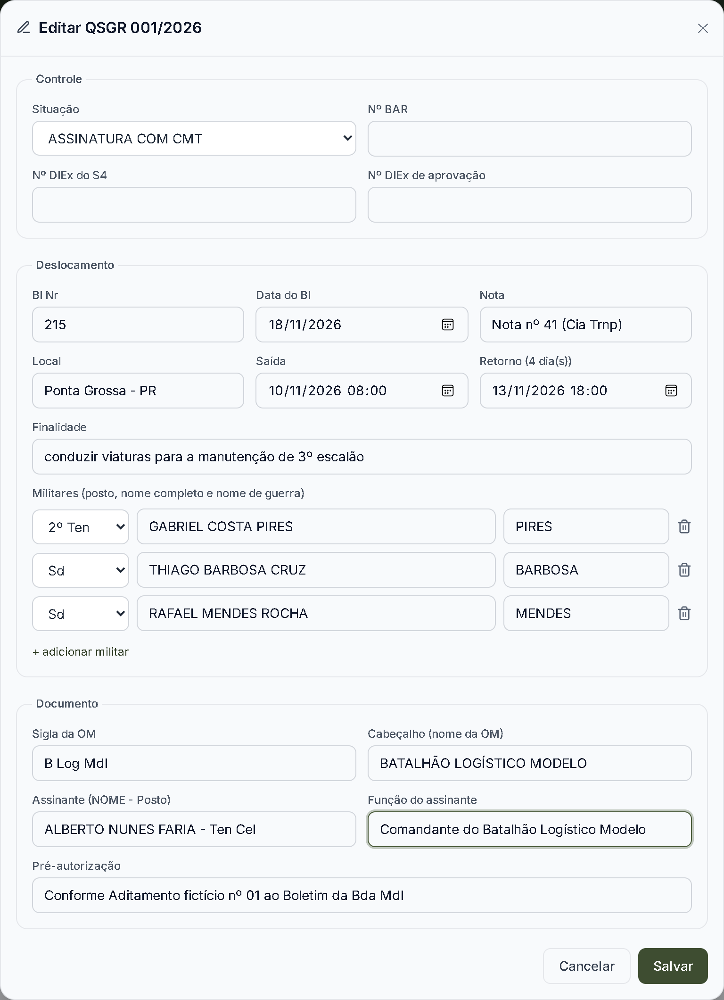
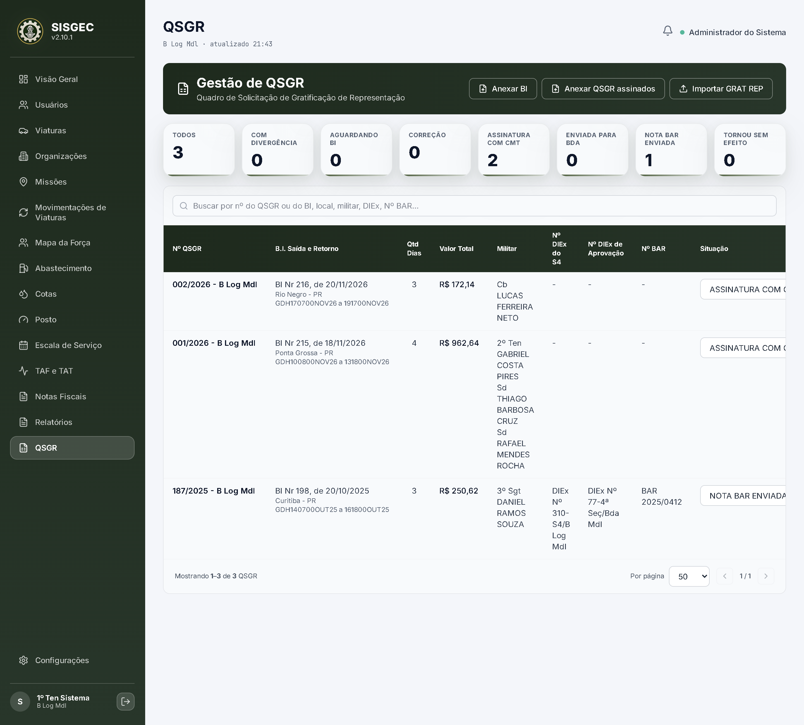
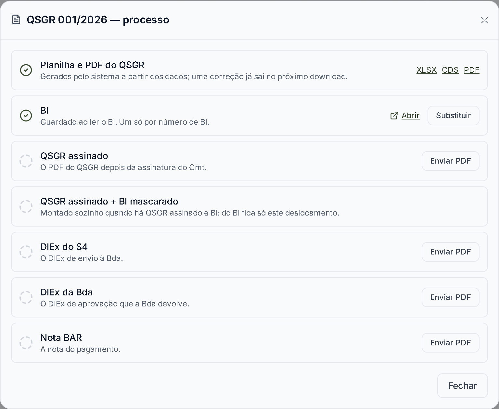

# QSGR

O **QSGR (Quadro de Solicitação de Gratificação de Representação)** é o documento que pede a gratificação dos militares deslocados a serviço. O módulo gera o QSGR a partir do deslocamento publicado no BI, numera, calcula dias e valor, e acompanha o processo até o pagamento. Ele substitui a planilha de controle (GRAT REP), cujo histórico pode ser importado.

> [!NOTE]
> Ao final deste capítulo, o usuário saberá:
>
> - gerar os QSGR a partir do BI;
> - entender a pendência "AGUARDANDO BI" e como ela se fecha;
> - acompanhar cada QSGR pela situação e pelas etapas do processo;
> - baixar a planilha e o PDF do QSGR.

> [!NOTE]
> **BIS DESTE CAPÍTULO**
>
> As telas usam dois BIs **fictícios** do B Log Mdl: o BI 215, com um deslocamento completo e outro só com a saída, e o BI 216, que publica o retorno que faltava.

## 1. O BI é a referência

O QSGR nasce do BI e só vale o que o BI publica. Dado que falta ou está errado se resolve **no boletim**, com uma publicação que completa ou torna sem efeito, e não ajustando o QSGR para parecer certo. Quando a S1 lê esse BI, o sistema corrige o registro sozinho.

## 2. Gerar os QSGR lendo o BI

1. Em **Escala de Serviço**, clique em **Ler BI** e escolha o PDF. Quem lê é a S1 (usuário com "Escala de: S1") ou o Administrador.
2. A parte **QSGR (deslocamentos)** mostra cada deslocamento: local, saída, retorno, dias e militares, com o que o sistema vai fazer.
3. Desmarque o que não deve entrar e clique em **Gravar no sistema**.

| Ação proposta | Quando acontece |
|---|---|
| novo QSGR (recebe número) | O BI publica saída e retorno |
| pendência: fica AGUARDANDO BI | O BI publica só a saída (os militares ainda estão fora) |
| fecha o ciclo do QSGR pendente | Este BI traz o retorno que faltava |
| corrige o QSGR pelo BI | O registro diverge do que o BI publica |
| já lançado | O deslocamento já tem QSGR. Marque só para ligar este BI ao processo |

Um deslocamento novo **com alerta** (posto não reconhecido, período sobreposto, data faltando) vem **desmarcado**, para conferir antes.

> [!WARNING]
> **BI SEM ASSINATURA**
>
> O BI sem assinatura digital grava normalmente, mas o documento final do processo (QSGR assinado + BI mascarado) só é montado com o **BI assinado**.

O resumo diz o que foi feito em cada módulo. Se algum item **não** foi gravado, o motivo aparece em vermelho. Corrija e leia o BI de novo: o que já entrou não duplica.

## 3. Número, dias e valor

- **Número oficial sem buraco.** O número só é dado quando o deslocamento tem saída e retorno. A pendência fica "Pendente", sem número, até o BI que a completa.
- **Dias:** cada 24 horas completas contam 1 dia; o resto conta mais 1 dia se for de 8 horas ou mais; o mínimo é 1 dia.
- **Valor:** dias × o valor diário do posto de cada militar, pela tabela de 2% do soldo.
- **Dados do documento** (sigla, cabeçalho, assinante, função e pré-autorização): vêm do último QSGR da OM e podem ser ajustados na edição. No **primeiro BI** de uma OM ainda não há QSGR de onde copiar o assinante: o QSGR é gravado assim mesmo e fica marcado "sem assinante" até alguém preencher na edição.

## 4. O painel e a lista

Os cartões contam os QSGR por situação. Clique num cartão para filtrar.

| Cartão | Significado |
|---|---|
| Com divergência | O que falta sanar pelo BI. Só zera quando tudo estiver resolvido |
| AGUARDANDO BI | Saída publicada, retorno ainda não |
| CORREÇÃO | Em correção |
| ASSINATURA COM CMT | Situação de todo QSGR recém-gerado |
| ENVIADA PARA BDA | Processo enviado |
| NOTA BAR ENVIADA | Pagamento lançado; processo encerrado |
| TORNOU SEM EFEITO | Anulado; processo encerrado |

A lista segue as colunas da planilha antiga: nº do QSGR, BI, dias, valor, militares, DIEx do S4, DIEx de aprovação, nº BAR e situação. A situação muda direto no seletor da linha. A busca procura por número do QSGR ou do BI, local, militar, DIEx ou nº BAR.

## 5. Pendência e divergências

No **lápis** de cada linha estão os dados de controle (situação, DIEx, nº BAR), do deslocamento e do documento. Quando há **divergência**, o quadro vermelho diz o que falta. Enquanto ela existir, o QSGR **não gera documento**.

## 6. Fechar a pendência com o BI seguinte

Quando sai o BI com o retorno, a leitura propõe **"fecha o ciclo do QSGR pendente"**. Ao gravar, a pendência recebe o próximo número, os dias e o valor são calculados e a situação passa a **ASSINATURA COM CMT**.

## 7. O processo de cada QSGR

O link **Processo** da linha abre as etapas, na ordem em que acontecem:

| Etapa | Como entra |
|---|---|
| Planilha e PDF do QSGR | Gerados na hora, a partir dos dados: uma correção já sai no próximo download |
| BI | Guardado ao ler o BI. Um só por número de BI |
| QSGR assinado | O PDF depois da assinatura do Cmt |
| QSGR assinado + BI mascarado | **Montado sozinho** quando há QSGR assinado e BI: do BI fica só este deslocamento |
| DIEx do S4 | O DIEx de envio à Bda |
| DIEx da Bda | O DIEx de aprovação que a Bda devolve |
| Nota BAR | A nota do pagamento |

**Em lote**, no alto da tela:
- **Anexar BI**: o sistema acha os QSGR pelo número e pela data impressos no BI.
- **Anexar QSGR assinados**: acha cada QSGR pelo número no nome do arquivo, como o sistema o baixa (ex.: "QSGR Nº 001_2026 - B Log Mdl_assinado.pdf").
- **Importar GRAT REP**: traz o histórico da planilha antiga.

## 8. Resumo

> [!TIP]
> - O QSGR nasce do **BI**, lido pela S1; nada é gravado antes de conferir.
> - Só recebe **número** quem tem saída e retorno; sem retorno, fica **AGUARDANDO BI**.
> - O BI seguinte **fecha o ciclo** sozinho.
> - Com **divergência**, não há documento: corrige-se no BI.
> - O documento final (QSGR assinado + BI mascarado) é **montado pelo sistema**.
